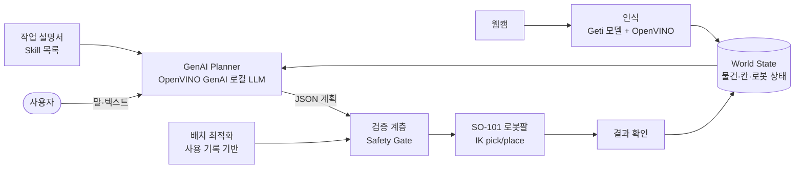

# Thursday — 작업실 AI 조수 로봇팔

**T**ask-aware **H**elper that **U**nderstands, **R**earranges & **S**ets up **D**esks **A**daptively for **Y**ou

> 작업하는 사람 옆에서 **준비 → 보조 → 정리**를 돕는, 인터넷 없이 Intel AI PC 한 대로 동작하는 피지컬 AI 조수

최종 프로젝트 | 기간 2026-11-26 ~ 2026-12-18 (구현 마감 12-17)

---

## 한눈에 보기

영화 속 작업실 조수 로봇팔처럼, 사람이 작업하는 동안 옆에서 필요한 물건을 꺼내 주고, 말하면 건네주고, 끝나면 다음 작업에 맞게 정리합니다.

| 단계 | 사용자가 하는 말 | 로봇이 하는 일 |
|---|---|---|
| 작업 전 · 준비 | "LED 실습 할 거야" | 작업에 필요한 부품을 찾아 작업 구역에 꺼내 둠, 빠진 부품 알림 |
| 작업 중 · 보조 | "저항 줘" | 해당 물건을 집어 정해진 전달 위치에 놓음 |
| 작업 후 · 정리 | "정리해 줘" | 사용 기록을 바탕으로 자주 쓰는 것·다음에 쓸 것을 가까운 칸에 배치 |

**범용성:** 작업 종류(전자회로 실습, 조립, 교육 수업 등)가 바뀌어도 **엔진 코드는 그대로**, 작업 설명서와 물건 목록만 바꿔서 같은 동작(집기·놓기·건네기)으로 돕습니다.

## 시스템 구성 (요약)

자세한 설계와 UML은 [docs/architecture.md](docs/architecture.md)에 있습니다.

## 핵심 설계 원칙

1. **LLM은 모터를 직접 움직이지 않는다.** LLM은 "무엇을 할지"를 JSON으로만 내고, 검증 계층이 확인한 뒤 등록된 Skill만 실행합니다.
2. **계산은 수학으로, 해석은 AI로.** 배치 최적화와 좌표 계산은 알고리즘이, 자연어 목표·설명서 해석과 예외 판단은 GenAI가 맡습니다.
3. **완전 오프라인.** 인식, LLM, 로봇 제어를 모두 Intel 노트북 한 대에서 처리합니다.
4. **숫자로 증명.** 성공률, 정리 전후 꺼내는 시간·팔 이동 거리, 규칙 기반 방식과의 비교를 측정합니다.

## 기술 스택

| 영역 | 기술 |
|---|---|
| 물체 인식 | Intel Geti (학습), OpenVINO Runtime (추론), NNCF (양자화) |
| 계획·대화 | OpenVINO GenAI 로컬 LLM, JSON schema 제약 출력 |
| 로봇 제어 | SO-101 + LeRobot, 역기구학(IK) 기반 pick/place, (선택) ACT 모방학습 |
| 하드웨어 | Intel Core Ultra 5 225H (CPU·iGPU·NPU), SO-101, 웹캠 |
| 언어 | Python |

## 문서

| 문서 | 내용 |
|---|---|
| [docs/vision.md](docs/vision.md) | 문제 정의, 대상 사용자, 성공 기준, 하지 않을 것 |
| [docs/usecases.md](docs/usecases.md) | 유즈케이스 다이어그램, 시나리오, 유저 스토리 |
| [docs/architecture.md](docs/architecture.md) | 시스템 아키텍처, 배치(장치) 구성, 클래스·시퀀스·상태 다이어그램 |
| [docs/interfaces.md](docs/interfaces.md) | 모듈 간 데이터 형식·함수 규격 (World State, Plan JSON, Skill, 실패 코드) — 초안 |
| [CONTRIBUTING.md](CONTRIBUTING.md) | **팀 협업 방법**: Issue → 브랜치 → PR → 리뷰 → 병합 |
| [AGENTS.md](AGENTS.md) | AI 도구(Claude Code, Codex 등) 공통 규칙 |
| [docs/workflow.md](docs/workflow.md) | 일정·Milestone, **애자일 방식(스프린트·백로그·DoD·회고)과 GitHub 연결**, GO/NO-GO |

## 팀과 역할

팀원: 신재석, 구경윤, 박휘성, 김효신 — **역할은 추후 결정** ([#1](https://github.com/Gansoolgo/Thursday/issues/1))

| 역할 | 주요 담당 | 담당자 |
|---|---|---|
| System Architect | 요구사항, World State·Skill 규격, 통합, 일정 | 추후 결정 |
| Vision Engineer | Geti 학습, 추론, 카메라-로봇 좌표 보정, 결과 확인 | 추후 결정 |
| GenAI Engineer | 로컬 LLM, 프롬프트, JSON 계획, 검증·예외 처리 | 추후 결정 |
| Robotics Engineer | SO-101, IK pick/place, 안전 정지, 최적 배치 | 추후 결정 |

## 일정

| Milestone | 기간 | 목표 |
|---|---|---|
| M1 기술 검증 | 11/26 ~ 12/02 | 장비 확인, 각 기술이 실제로 되는지 GO/NO-GO 판정 |
| M2 핵심 모듈 | 12/03 ~ 12/09 | 인식, pick/place, LLM 계획을 각각 단독으로 동작 |
| M3 통합 | 12/10 ~ 12/14 | 말 한마디부터 결과 확인까지 준비·보조·정리 종단 동작 |
| M4 완성·측정 | 12/15 ~ 12/17 | 두 번째 작업 종류 시연, 반복 시험·측정, **구현 마감** |
| M5 발표 | 12/18 | 라이브 데모, 발표 |

## 현재 상태

기획 단계(출발 준비)입니다. 코드와 하드웨어 검증 결과는 아직 없습니다. 위 설계는 M1 기술 검증 결과에 따라 바뀔 수 있습니다.

## AI 도구 사용 공개

이 프로젝트의 기획 정리와 문서 작성에 ChatGPT와 Claude(Claude Code)를 사용했습니다. 사용 내역은 커밋 메시지(`Co-Authored-By`)와 문서에 남깁니다.
