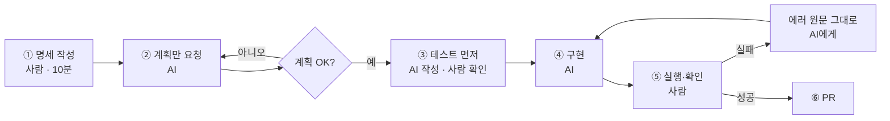

# AI에게 일 맡기는 법 — 빠르게, 덜 고치게

> **📌 3줄 요약**
> - **사람이 정하고, AI가 채운다.** 사람은 *무엇을·경계·완료 조건*을 정하고, AI는 *구현*을 합니다.
> - 지시서 = **Issue 명세 6칸** (목표 · 입력/출력 · 수정할 파일 · 건드리지 말 것 · 완료 조건 · 확인 방법). 10분 투자로 수정 왕복을 줄입니다.
> - 순서는 **계획 먼저 → 테스트 먼저 → 구현 → 사람이 실행해서 확인.** 한 번에 크게 시키지 않습니다.
>
> 어떤 AI를 쓰든(Claude Code, Codex, ChatGPT) 같은 원칙입니다. AI가 지킬 규칙은 [AGENTS.md](../AGENTS.md)에 있습니다.
> 📖 낯선 말은 👉 [용어집](glossary.md)

---

## 1. 수정이 많아지는 이유

| 원인 | 결과 | 막는 법 |
|---|---|---|
| "hand_over 만들어 줘"처럼 **모호한 지시** | AI가 빈칸을 추측해서 채움 → 내 생각과 다름 | 명세 6칸 (2장) |
| **입력·출력 형식이 안 정해짐** | 각자 AI가 다른 형식으로 만듦 → 통합 때 다 고침 | [interfaces.md](interfaces.md)를 기준으로 지시 |
| **범위가 큼** ("Vision 모듈 전부") | 길고 틀린 코드, 리뷰 불가 | 하루 이하·파일 3~5개로 쪼개기 |
| **완료 조건이 없음** | 언제 끝났는지 모름, "다 됐어요"를 믿게 됨 | 완료 조건을 **테스트로** 먼저 |
| **AI가 맥락을 모름** | 이미 있는 코드를 또 만들거나 규칙 위반 | 관련 파일 경로를 명시, AGENTS.md |
| **실행해 보지 않음** | 나중에 한꺼번에 터짐 | 작업마다 사람이 실행해서 확인 |

## 2. 지시서: Issue 명세 6칸

작업을 시작하기 전에 **Issue에 이 6칸을 채웁니다.** 이 Issue 본문이 그대로 AI 지시서가 되고, 팀원이 내 작업을 이해하는 문서도 됩니다. [작업 Issue 템플릿](../.github/ISSUE_TEMPLATE/task.md)에 칸이 준비돼 있습니다.

| 칸 | 쓰는 것 | 나쁜 예 → 좋은 예 |
|---|---|---|
| **① 목표** | 한 문장. 무엇을 왜 | "전달 기능" → "물건을 전달 칸 H에 놓는 `hand_over` Skill을 만든다 (US-03)" |
| **② 입력 / 출력** | 함수 모양, 데이터 형식, **예시 값** | "World State 받아서 처리" → "`execute(step: PlanStep, world: WorldState) -> SkillResult`, interfaces.md 5장. 예: step=`{skill: hand_over, object_id: block_blue_0}` → `status=SUCCESS, observations={placed_slot: H}`" |
| **③ 수정할 파일** | 만들거나 고칠 파일 목록 | (없음) → "`app/skills/hand_over.py`(새로), `tests/test_hand_over.py`(새로)" |
| **④ 건드리지 말 것** | 바꾸면 안 되는 것 | (없음) → "`app/core/types.py` 수정 금지, 실제 로봇 실행 금지, 새 패키지 설치 금지" |
| **⑤ 완료 조건** | **테스트로 확인할 수 있는** 문장 | "잘 동작" → "① H가 비면 SUCCESS ② H가 차 있으면 FAILED + `SLOT_OCCUPIED` ③ 물건이 없으면 `OBJECT_NOT_FOUND` ④ MockRobotArm으로 pytest 통과" |
| **⑥ 확인 방법** | 사람이 직접 볼 방법 | (없음) → "`pytest tests/test_hand_over.py -v`, 그다음 실제 로봇 저속 3회" |

> **⑤가 가장 중요합니다.** 완료 조건이 테스트로 바뀌면, AI는 그 테스트를 통과할 때까지 스스로 고치고, 사람은 테스트 결과만 보면 됩니다.

## 3. 진행 순서



| 단계 | 누가 | 핵심 |
|---|---|---|
| ① 명세 | 사람 | 2장 6칸. 여기서 아낀 10분이 나중에 1시간이 됩니다 |
| ② 계획 | AI → 사람 | **"코드 쓰지 말고 계획만"**. 어떤 파일에 무엇을 어떻게 할지 보고 틀린 방향을 미리 자릅니다 |
| ③ 테스트 | AI → 사람 | 완료 조건을 테스트로. **사람이 테스트가 맞는지 읽어 봅니다** (테스트가 틀리면 구현도 틀림) |
| ④ 구현 | AI | 테스트를 통과할 때까지 |
| ⑤ 확인 | 사람 | **직접 실행.** AI의 "통과했습니다"를 믿지 말고 결과를 눈으로 봅니다 |
| ⑥ PR | 사람 (AI가 초안) | PR 템플릿 채우기, AI 사용 내역 기록 |

## 4. 수정을 줄이는 7가지 원칙

1. **계약 먼저.** 모듈 사이 형식([interfaces.md](interfaces.md))과 공통 타입(`app/core/types.py`), Mock을 **먼저 main에 넣고** 각자 구현합니다. 4명의 AI가 같은 계약을 보고 만들면 통합 수정이 거의 없습니다.
2. **샘플 데이터 공유.** 고정된 예시 입력(카메라 사진, World State JSON, 사용자 말 목록)을 `samples/`에 두고 모두 같은 걸로 테스트합니다. "내 PC에선 됐는데"가 사라집니다.
3. **작게 자르기.** 한 번에 맡기는 일은 **하루 이하, 파일 3~5개, 함수 몇 개.** 크면 AI도 사람도 검토를 못 합니다.
4. **한 번에 하나만 고치기.** 수정 요청은 하나씩. 여러 개를 섞으면 무엇이 무엇을 고쳤는지 모릅니다.
5. **두 번 실패하면 멈추기.** 같은 문제로 AI가 두 번 틀리면 계속 시키지 말고, 명세가 모호한지 보거나 접근을 바꾸거나 팀원에게 묻습니다.
6. **결정은 문서에.** "좌표는 mm로", "재시도 2회"처럼 정한 건 문서·Issue에 남깁니다. AI는 대화를 기억하지 못하지만 문서는 읽습니다.
7. **같은 실수 두 번이면 규칙으로.** AI가 같은 실수를 반복하면 [AGENTS.md](../AGENTS.md)에 한 줄 추가합니다(PR로). 그러면 4명의 AI 모두 고쳐집니다.

## 5. 맥락 주는 법

AI는 **우리 프로젝트를 모릅니다.** 알려 줘야 할 것:

| 줄 것 | 방법 |
|---|---|
| 프로젝트 규칙 | Claude Code는 `CLAUDE.md` → `AGENTS.md`를 자동으로 읽음. Codex도 `AGENTS.md`를 읽음. ChatGPT 등은 AGENTS.md 내용을 붙여 넣기 |
| 관련 파일 | 경로를 정확히: "`app/core/types.py`의 `WorldState`와 `docs/interfaces.md` 5장을 읽고" (Claude Code는 `@파일경로`) |
| 에러 | **원문 그대로 전부** 붙여 넣기 (요약하지 않기) + 실행한 명령 |
| 하드웨어 결과 | 로봇·카메라는 AI가 직접 못 봄 → 사람이 실행한 **로그·사진·측정값**을 붙여 줌 |
| 하지 말 것 | 명세 ④칸. 특히 "실제 로봇 실행 금지", "공통 파일 수정 금지" |

## 6. 복사해서 쓰는 프롬프트

`#10` 같은 번호와 경로만 바꿔 쓰세요.

<details>
<summary><b>① 계획 요청</b> — 코드 쓰기 전에</summary>

```text
GitHub Issue #10의 명세를 읽고 작업 계획만 세워 줘. 아직 코드는 쓰지 마.
참고: AGENTS.md, docs/interfaces.md 5장, app/core/types.py
알려 줄 것:
1. 만들거나 고칠 파일과 각 파일에서 할 일
2. 테스트할 경우 목록 (완료 조건 → 테스트 케이스)
3. 명세에서 모호하거나 interfaces.md와 안 맞는 부분 (있으면 질문)
4. 건드려야 할 것 같은데 명세 ④칸에 막힌 것
```
</details>

<details>
<summary><b>② 테스트 먼저</b></summary>

```text
계획대로 tests/test_hand_over.py만 먼저 작성해 줘. 구현 코드는 아직 쓰지 마.
- 완료 조건 하나당 테스트 하나
- 로봇은 MockRobotArm, World State는 samples/의 고정 데이터 사용
- 지금은 구현이 없으니 테스트가 실패하는 게 정상
```
</details>

<details>
<summary><b>③ 구현</b></summary>

```text
tests/test_hand_over.py를 통과하도록 app/skills/hand_over.py를 구현해 줘.
- 명세 ③칸의 파일만 수정. 다른 파일을 바꿔야 하면 바꾸지 말고 먼저 알려 줘
- interfaces.md의 형식(이름, 필드, 단위 mm)을 그대로 따를 것
- 다 되면 pytest와 ruff check를 실제로 실행하고 결과 원문을 보여 줘
- 실행하지 않은 걸 통과했다고 하지 마
```
</details>

<details>
<summary><b>④ 에러 고치기</b></summary>

```text
아래 명령을 실행했더니 에러가 났어. 원인을 먼저 설명하고, 고칠 방법을 제안한 다음 고쳐 줘.
한 번에 이 에러 하나만 고쳐.

실행한 명령:
<명령>

에러 원문:
<전체 붙여 넣기>

내가 이미 해 본 것:
<있으면>
```
</details>

<details>
<summary><b>⑤ 실제 로봇 결과 전달</b></summary>

```text
실제 로봇에서 hand_over를 저속으로 5번 돌렸어. 결과:
- 성공 3 / 실패 2
- 실패 모습: 물건을 집었는데 H 칸 중심에서 약 15mm 왼쪽에 놓음 (2번 모두)
- 로그: <붙여 넣기>
원인 후보를 확률 순으로 말해 주고, 코드를 고치기 전에 확인해 볼 것을 먼저 알려 줘.
```
</details>

<details>
<summary><b>⑥ 셀프 리뷰 (PR 올리기 전)</b></summary>

```text
지금 브랜치의 main 대비 변경을 리뷰해 줘. CONTRIBUTING.md 5장 "꼭 볼 것" 기준으로.
특히: interfaces.md 위반, 명세 ③칸 밖의 파일 변경, 테스트 누락, 로봇 안전(저속 기본값, stop()).
문제마다 파일:줄과 이유를 적고, 고치지는 마.
```
</details>

<details>
<summary><b>⑦ PR 본문 초안</b></summary>

```text
지금 브랜치 변경으로 PR 본문을 .github/pull_request_template.md 형식에 맞게 써 줘.
"확인 방법"에는 내가 실제로 실행한 명령과 결과만 넣고, 안 한 건 "미확인"으로 적어 줘.
```
</details>

## 7. 하지 말 것

| 하지 말 것 | 왜 |
|---|---|
| "Vision 모듈 전부 만들어 줘" | 너무 큼 → 검토 불가, 계약 위반 가능성 높음 |
| AI가 `interfaces.md`·`types.py`를 마음대로 바꾸게 두기 | 다른 3명 코드가 깨짐. 바꿀 땐 사람이 결정하고 리뷰 받기 |
| AI에게 실제 로봇을 움직이는 명령을 실행시키기 | 안전. 로봇 실행은 사람이 |
| "다 됐습니다"만 보고 PR | 직접 실행해서 확인한 것만 PR에 적기 |
| 이해 못 한 코드를 병합 | 발표·질문에서 설명 못 함. 최소한 무엇을 하는 코드인지는 설명할 수 있어야 함 |
| 에러를 요약해서 전달 | AI가 엉뚱한 원인을 짚음. 원문 그대로 |

## 8. 팀 차원에서 할 일 (출발 준비)

| 언제 | 할 일 | 효과 |
|---|---|---|
| 12/02 (M1 끝) | interfaces.md 확정 | 4명의 AI가 같은 계약을 봄 |
| 12/03 (M2 첫날) | **System 담당이 `app/core/types.py` + Mock(`MockRobotArm`, `MockVision`) + `samples/` 먼저 병합** | 각자 독립 개발 가능, 통합 수정 최소 |
| 매 스프린트 회고 | AI가 반복한 실수를 AGENTS.md에 추가 | 같은 실수가 4명 모두에서 사라짐 |
