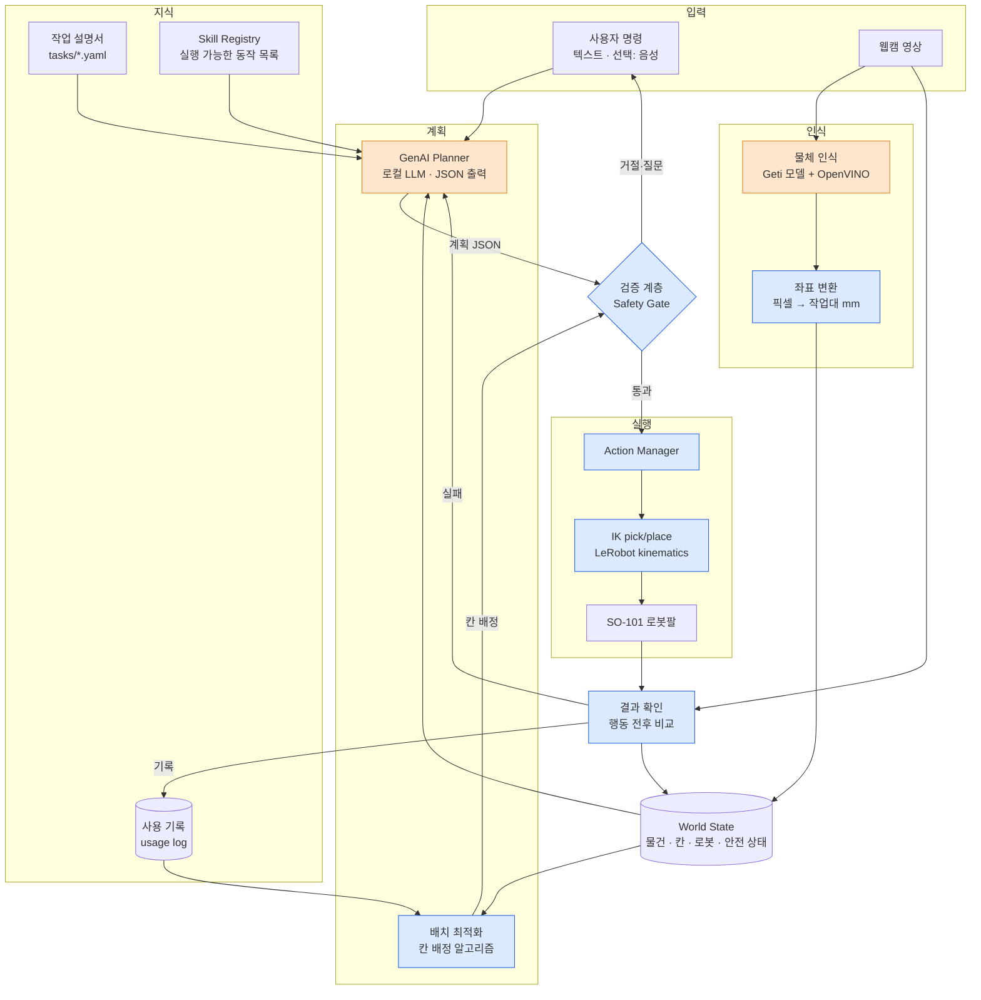
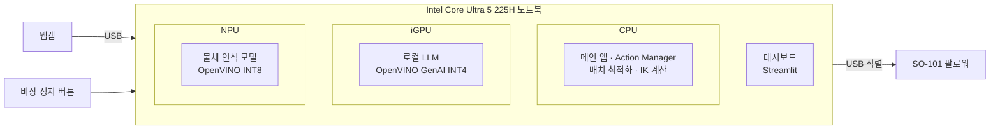
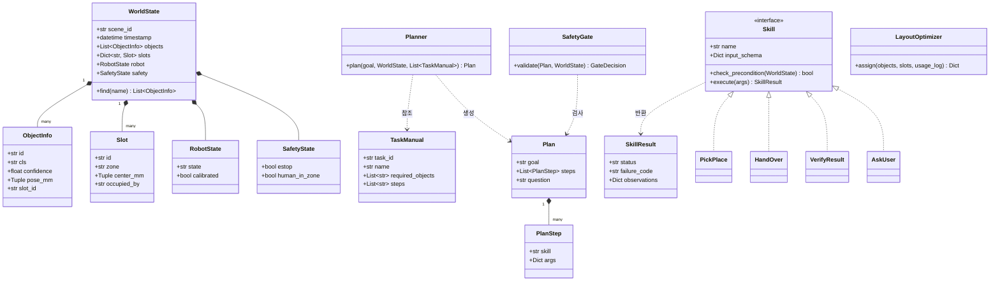
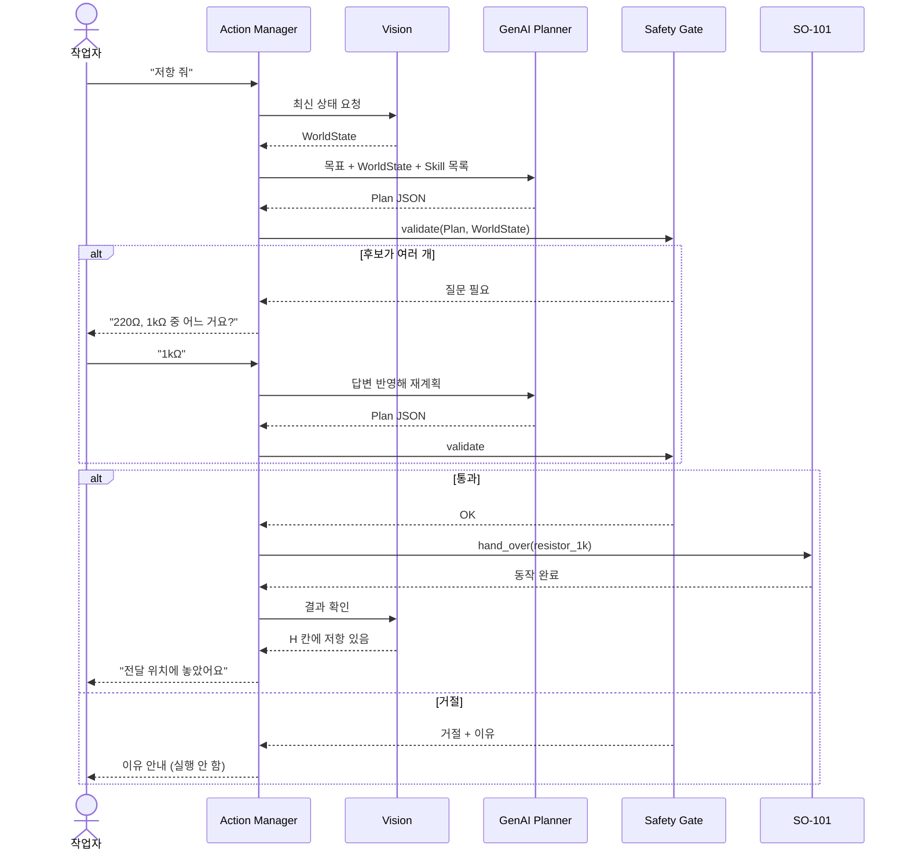
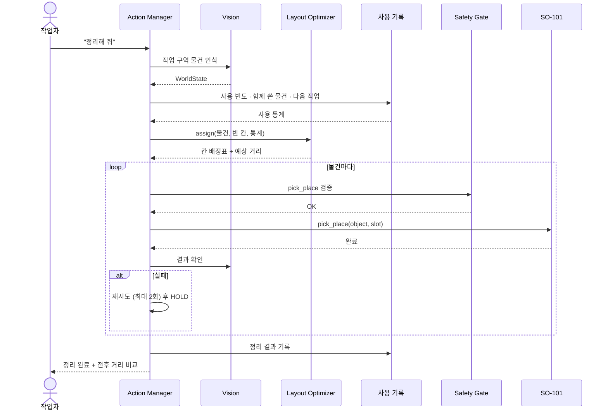
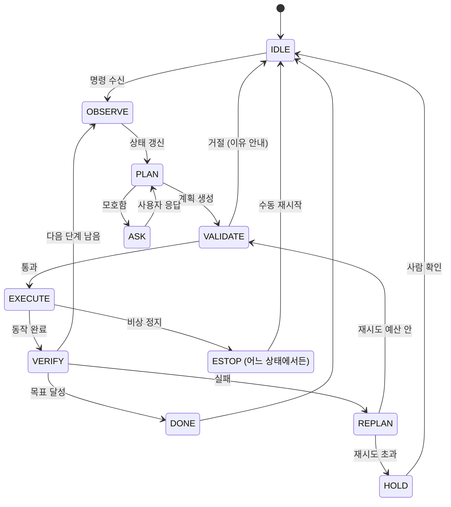
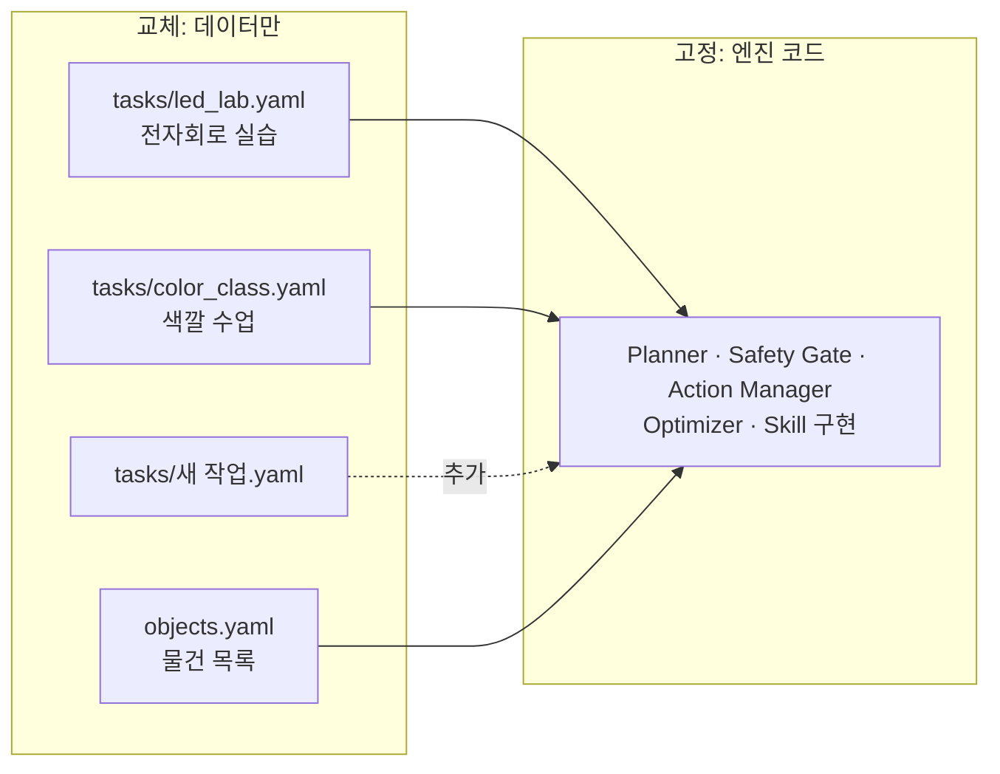

# 시스템 아키텍처 (High Level Design)

> **📌 3줄 요약**
> - 흐름: **말 → LLM 계획(JSON) → Safety Gate → 로봇 실행 → 카메라로 확인 → 실패하면 재계획.**
> - AI가 판단하는 부분(Planner, 인식)과 결정론적으로 계산·검사하는 부분(좌표, 최적화, Gate, 실행)을 분리.
> - 모든 계산은 노트북 한 대: LLM은 iGPU, 인식은 NPU, 제어는 CPU (M1에서 실측 후 확정).
> 📖 낯선 말은 👉 [용어집](glossary.md)

> 상태: 초안 v0.2 (2026-11-26). M1 기술 검증 결과에 따라 바뀔 수 있습니다. 아직 구현된 코드는 없습니다.

## 목차
1. [전체 구조](#1-전체-구조)
2. [장치 배치 (Deployment)](#2-장치-배치-deployment)
3. [모듈별 역할](#3-모듈별-역할)
4. [클래스 다이어그램: 공통 데이터와 Skill](#4-클래스-다이어그램-공통-데이터와-skill)
5. [시퀀스 다이어그램](#5-시퀀스-다이어그램)
6. [상태 다이어그램: 실행 FSM](#6-상태-다이어그램-실행-fsm)
7. [범용성을 만드는 구조](#7-범용성을-만드는-구조)
8. [안전 설계](#8-안전-설계)
9. [폴더 구조](#9-폴더-구조)

---

## 1. 전체 구조

입력 → 이해 → 계획 → 검증 → 실행 → 확인의 닫힌 루프입니다. **AI가 판단하는 부분(주황)** 과 **결정론적으로 계산·검사하는 부분(파랑)** 을 분리했습니다.



## 2. 장치 배치 (Deployment)

모든 계산은 **Intel 노트북 한 대**에서 합니다. 인터넷은 쓰지 않습니다. 장치 배정은 계획이며 M1에서 실측해 확정합니다.



| 장치 | 맡는 일 | 이유 |
|---|---|---|
| iGPU | 로컬 LLM | 생성 모델은 메모리·연산량이 커서 iGPU가 적합 |
| NPU | 물체 인식 | 정적 입력 크기의 작은 모델을 저전력으로 상시 실행 |
| CPU | 제어 루프, IK, 최적화, 검증 | 결정론적·저지연 처리 |

## 3. 모듈별 역할

| 모듈 | 하는 일 | 하지 않는 일 |
|---|---|---|
| Vision | 물건 종류·위치 인식, 픽셀 → 작업대 좌표 변환, 칸 점유 판단 | 학습하지 않은 물건의 신뢰성 보장 |
| GenAI Planner | 자연어 목표·작업 설명서 해석, Skill 조합 계획(JSON), 모호하면 질문 생성 | 모터 명령 생성, 안전 규칙 변경 |
| Layout Optimizer | 사용 기록으로 물건별 칸 배정 (가까운 칸 = 자주·곧 쓸 물건) | 자연어 해석 |
| Safety Gate | 스키마·대상 존재·좌표 범위·금지 동작·재시도 횟수 검사 | 계획 수정 (거절·질문만) |
| Action Manager | Skill 순서 실행, 단계마다 상태 재확인, 시간 제한·실패 처리 | 계획 생성 |
| Robot (IK) | 목표 좌표로 집기·놓기, 속도·작업 영역 제한 | 판단 |
| Verifier | 행동 전후 영상 비교로 성공 판정, 사용 기록 저장 | |

## 4. 클래스 다이어그램: 공통 데이터와 Skill

모듈 사이에 주고받는 데이터 형식입니다. 이 형식을 먼저 합의해야 팀원이 동시에 개발할 수 있습니다. 필드·JSON 스키마·실패 코드 상세는 [interfaces.md](interfaces.md)에 있습니다.



### 등록할 Skill (초안)

| Skill | 인자 | 실행 조건 | 성공 판정 |
|---|---|---|---|
| `detect_objects` | 없음 | 카메라 정상 | 인식 목록 갱신 |
| `pick_place` | object_id, slot_id | 대상 존재, 목표 칸 비어 있음, 좌표가 작업 범위 안 | 행동 후 대상이 목표 칸에 있음 |
| `hand_over` | object_id | 전달 위치(H) 비어 있음 | 대상이 H에 있음 |
| `optimize_layout` | 없음 | 사용 기록 존재 | 칸 배정표 반환 |
| `verify_result` | goal_id | 최신 영상 | 목표 조건과 일치 |
| `ask_user` | question | 모호·정보 부족 | 사용자 응답 수신 |

공통 반환 `status`: `SUCCESS` / `FAILED` / `UNAVAILABLE` / `HOLD`

## 5. 시퀀스 다이어그램

### 5-1. 작업 중 보조: "저항 줘"



### 5-2. 작업 후 정리: "정리해 줘"



## 6. 상태 다이어그램: 실행 FSM



## 7. 범용성을 만드는 구조



새 작업을 추가할 때 **엔진 코드는 바꾸지 않고**, 작업 설명서와 물건 목록만 추가합니다. 이때 걸린 시간과 코드 수정 줄 수를 측정해 규칙 기반 방식(작업마다 동작 코드를 새로 작성)과 비교합니다 ([vision.md H1](vision.md)).

작업 설명서 예시 (초안):

```yaml
task_id: led_lab
name: LED 회로 실습
required_objects: [breadboard, led_red, resistor_220, jumper_wires, battery_holder]
notes: 저항은 LED 바로 옆에 둔다
```

## 8. 안전 설계

| 위험 | 대응 |
|---|---|
| LLM이 잘못된 계획을 냄 | JSON schema 제약 출력, 등록된 Skill·물건만 허용, 좌표 범위 검사, 재시도 횟수 제한 |
| 사람이 작동 영역에 손을 넣음 | 로봇이 멈춘 뒤에만 물건 변경, 저속 운전, 물리적 비상 정지. **카메라 감지만으로 안전을 보장하지 않음** |
| 좌표 오차로 물건 떨어뜨림 | 고정 지그·칸, 가벼운 물체, 보정 후 오차 측정, 행동 후 결과 확인 |
| 장치 통신 끊김 | 시간 제한, watchdog, 안전 정지 |

## 9. 폴더 구조 (예정)

```text
Thursday/
├── app/
│   ├── ui/          # Streamlit 대시보드, CLI
│   ├── core/        # WorldState, Planner, SafetyGate, ActionManager, Optimizer
│   ├── vision/      # 인식, 좌표 변환
│   ├── skills/      # Skill 구현 (pick_place, hand_over ...)
│   └── hw/          # SO-101·카메라 접근 (실제 + mock)
├── tasks/           # 작업 설명서 (*.yaml)
├── config/          # 물건 목록, 칸 좌표, 보정값
├── tests/           # pytest (하드웨어는 mock)
├── docs/            # 이 문서들
└── requirements.txt
```
