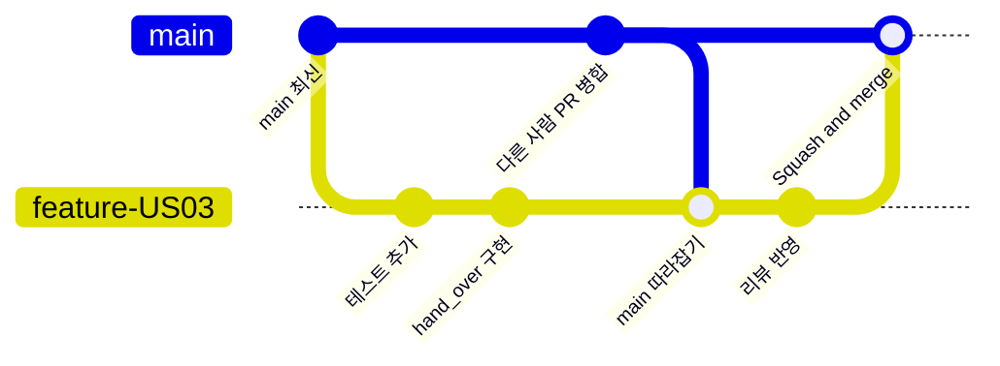

# Git · GitHub 실전 가이드

> **📌 3줄 요약**
> - 처음 한 번: Git 설정 → 저장소 받기 → 가상환경 만들기 (1장)
> - 매일: **main 최신화 → 브랜치 → 커밋 → push → PR → 병합 → main 최신화** (2장)
> - 실수해도 대부분 되돌릴 수 있습니다. 당황하지 말고 6장 표를 보고, 모르면 Discord에 묻기.
>
> 규칙(무엇을 지켜야 하나)은 [CONTRIBUTING.md](../CONTRIBUTING.md), 이 문서는 **실제로 어떻게 하나**입니다.

명령은 모두 **Windows PowerShell** 기준입니다. VS Code의 Git 화면이나 GitHub Desktop을 써도 되지만, 막혔을 때 서로 도와주기 쉽도록 명령어 기준으로 적었습니다.

---

## 1. 처음 한 번 (10분)

```powershell
# 1) 내 이름·이메일 (GitHub 계정과 같은 이메일)
git config --global user.name "홍길동"
git config --global user.email "me@example.com"

# 2) 기본 브랜치 이름과 pull 방식
git config --global init.defaultBranch main
git config --global pull.rebase false

# 3) 저장소 받기
cd $HOME\Desktop
git clone https://github.com/Gansoolgo/Thursday.git
cd Thursday

# 4) 가상환경과 개발 도구 (코드가 생기면 requirements.txt도 설치)
py -3.12 -m venv .venv
.\.venv\Scripts\Activate.ps1
python -m pip install -r requirements-dev.txt
```

- GitHub 로그인 창이 뜨면 브라우저로 로그인하면 됩니다 (Git Credential Manager).
- `Activate.ps1` 실행이 막히면: `Set-ExecutionPolicy -Scope CurrentUser RemoteSigned` 후 다시.

## 2. 하루 흐름



### ① 시작: main 최신화 → 브랜치

```powershell
git switch main
git pull
git switch -c feature/US-03-hand-over
```

> 💡 GitHub Issue 화면 오른쪽 **Development → Create a branch**로 만들어도 됩니다. 그러면 Issue와 브랜치가 자동으로 연결됩니다. 만든 뒤 `git fetch` → `git switch <브랜치>`.

### ② 작업 중: 자주 커밋

```powershell
git status                      # 무엇이 바뀌었나
git diff                        # 어떻게 바뀌었나
git add app/skills/hand_over.py tests/test_hand_over.py
git commit -m "US-03: hand_over 성공 판정 추가 (#10)"
```

- `git add .`는 편하지만 원치 않는 파일까지 들어갈 수 있습니다. **커밋 전 `git status`를 꼭 봅니다.**
- 작게, 자주. "동작하는 작은 단위" 하나가 커밋 하나입니다.

### ③ 올리기: push → PR

```powershell
git push -u origin feature/US-03-hand-over   # 처음 한 번만 -u, 이후엔 git push
```

GitHub에 노란 배너 **Compare & pull request** → 템플릿 채우기 → `Closes #10` → Create.

### ④ 다른 사람이 먼저 병합했으면: main 따라잡기

PR에 "This branch is out-of-date" 또는 충돌 표시가 뜨면:

```powershell
git switch main
git pull
git switch feature/US-03-hand-over
git merge main
git push
```

충돌이 없으면 PR 화면의 **Update branch** 버튼 한 번으로도 됩니다.

### ⑤ 끝: 병합 후 정리

PR에서 **Squash and merge** → **Delete branch**. 그다음 내 PC:

```powershell
git switch main
git pull
git branch -d feature/US-03-hand-over
git fetch --prune        # GitHub에서 지운 브랜치 흔적 정리
```

## 3. 충돌 해결

같은 파일의 같은 부분을 두 사람이 고쳤을 때 생깁니다.

```text
<<<<<<< HEAD
    speed = 0.3          ← 내 브랜치
=======
    speed = 0.2          ← main
>>>>>>> main
```

1. 둘 중 맞는 것(또는 합친 것)만 남기고 `<<<<<<<` `=======` `>>>>>>>` 줄을 지웁니다.
2. `git add <파일>` → `git commit` → `git push`
3. **어느 쪽이 맞는지 모르겠으면 고치지 말고** 그 부분을 쓴 사람과 같이 봅니다 (`git log -p <파일>`로 누가 고쳤는지 확인).

VS Code는 충돌 부분에 **Accept Current / Accept Incoming / Accept Both** 버튼을 띄워 줍니다.

**충돌을 줄이는 법:** 브랜치를 짧게 유지하고, 하루 한 번 main을 따라잡고, 공통 파일은 미리 알리고 고칩니다.

## 4. GitHub 기능 활용

| 기능 | 어디서 | 쓰는 법 |
|---|---|---|
| **Issue에서 브랜치 만들기** | Issue 오른쪽 Development | 브랜치·PR이 Issue에 자동 연결 |
| **Closes #번호** | PR 본문 | 병합하면 Issue 자동 종료 |
| **Draft PR** | PR 만들 때 ▼ 화살표 | "아직 작업 중, 의견 주세요" |
| **@멘션** | Issue·PR 댓글 | `@아이디` 로 특정 사람 호출 (알림 감) |
| **줄 단위 코멘트** | PR → Files changed → 줄 왼쪽 `+` | 그 줄에 대한 의견 |
| **Suggestion** | 줄 코멘트에서 ± 아이콘 | 고칠 코드를 직접 제안 → 작성자가 클릭 한 번으로 반영 |
| **필터** | Issues 검색창 | `is:open assignee:@me` 내 할 일 · `milestone:"M1 기술 검증"` · `label:spike` |
| **Milestone 진행률** | [Milestones](https://github.com/Gansoolgo/Thursday/milestones) | 이번 단계가 몇 % 끝났나 |
| **Projects 보드** | 조직 Projects | 칸반: Todo / In Progress / Review / Done (아래 5장) |
| **Actions** | 저장소 Actions 탭 | CI 결과·로그. 빨간색이면 눌러서 어느 줄이 실패했는지 확인 |

## 5. 칸반 보드 (GitHub Projects)

애자일 스프린트 보드입니다. 누가 무엇을 하는지 한눈에 보입니다.

| 칸 | 의미 | 언제 옮기나 |
|---|---|---|
| 📋 Todo | 이번 스프린트에 할 것 | 스프린트 계획 회의 |
| 🔨 In Progress | 작업 중 | 브랜치 만들 때 |
| 👀 Review | PR 열림 | PR 열 때 (자동 가능) |
| ✅ Done | 병합됨 | 병합 시 자동 |

## 6. 실수했을 때

| 상황 | 해결 |
|---|---|
| **main에서 작업하고 커밋까지 했다** (아직 push 안 함) | `git switch -c feature/새브랜치` → 커밋이 새 브랜치로 따라옴 → `git switch main` → `git reset --hard origin/main` |
| **커밋 메시지를 잘못 썼다** (push 전) | `git commit --amend -m "새 메시지"` |
| **파일을 빠뜨리고 커밋했다** (push 전) | `git add 빠진파일` → `git commit --amend --no-edit` |
| **아직 커밋 안 한 변경을 버리고 싶다** | `git restore <파일>` (되돌릴 수 없으니 주의) |
| **add를 취소하고 싶다** | `git restore --staged <파일>` |
| **다른 브랜치로 가야 하는데 작업이 덜 됐다** | `git stash` → 이동해서 볼일 → 돌아와서 `git stash pop` |
| **push가 거절됐다** (`rejected`) | 원격에 새 커밋이 있음 → `git pull` → (충돌 해결) → `git push` |
| **main에 push가 거절됐다** | 정상입니다 (보호 규칙). 브랜치를 만들어 PR로 올리기 |
| **비밀값(키)을 커밋했다** | **push 전이면** `git reset --soft HEAD~1`로 커밋 취소 후 파일 수정. **push했으면 즉시 Discord에 알리고 키를 폐기·재발급** (기록에 남아 있으므로 지우는 것만으로는 부족) |
| **큰 모델 파일을 커밋했다** (push 전) | `git reset --soft HEAD~1` → `.gitignore` 확인 → 다시 커밋 |
| **뭐가 뭔지 모르겠다** | 아무것도 지우지 말고 `git status`, `git log --oneline -5` 결과를 Discord에 붙여서 질문 |

**절대 하지 말 것:** `git push --force` (main은 막혀 있지만, 공유 브랜치에서도 쓰지 않습니다)

## 7. 자주 쓰는 명령

| 하고 싶은 것 | 명령 |
|---|---|
| 상태 보기 | `git status` |
| 최근 기록 | `git log --oneline -10` |
| 바뀐 내용 | `git diff` (add 전) · `git diff --staged` (add 후) |
| 브랜치 목록 | `git branch` · 원격 포함 `git branch -a` |
| 브랜치 이동 | `git switch <이름>` |
| 다른 사람 브랜치 받아 보기 | `git fetch` → `git switch <이름>` |
| 이 파일 누가 고쳤나 | `git log -p <파일>` |
