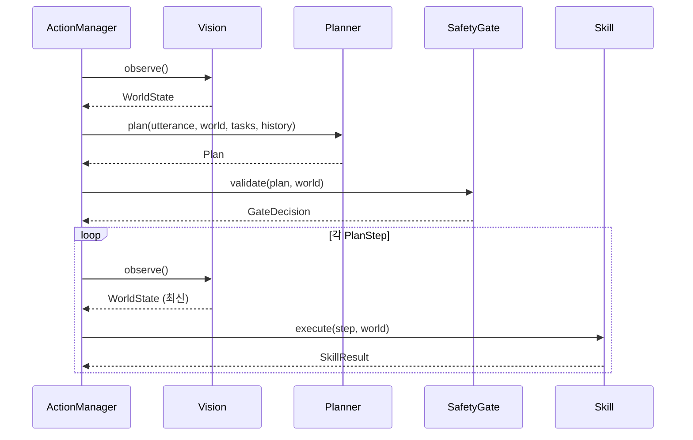

# 인터페이스 규격 (초안 v0.1)

> **📌 3줄 요약**
> - 모듈끼리 주고받는 **데이터 형식과 함수 모양**의 약속. 코드 짜기 전에 내 모듈 부분을 꼭 읽습니다.
> - 단위 **mm**, 좌표계 `table`, LLM은 **칸 ID만** 담은 평평한 JSON을 내고 좌표는 코드가 계산.
> - 새 작업 추가 = `tasks/*.yaml`·`config/objects.yaml` 데이터만 추가 (엔진 코드 수정 없음).
> 📖 낯선 말은 👉 [용어집](glossary.md)

> 상태: **초안 — 팀 합의 전** (Issue [#8](https://github.com/Gansoolgo/Thursday/issues/8)). 12/02 GO/NO-GO 회의에서 확정합니다.
> 목적: 4명이 모듈을 따로 개발해도 M3에서 그대로 합쳐지도록, 모듈 사이에 주고받는 **데이터 형식과 함수 모양**을 먼저 정합니다.
> 이 문서의 Python 코드는 규격을 설명하는 예시입니다. 실제 코드는 `app/core/types.py`에 이 문서와 똑같이 만듭니다.

## 목차
0. [공통 약속](#0-공통-약속)
1. [World State](#1-world-state)
2. [설정 파일: 물건·칸·작업 설명서](#2-설정-파일-물건칸작업-설명서)
3. [Plan: LLM 출력 형식](#3-plan-llm-출력-형식)
4. [Gate 판정](#4-gate-판정)
5. [Skill과 실행 결과](#5-skill과-실행-결과)
6. [사용 기록과 배치 최적화](#6-사용-기록과-배치-최적화)
7. [모듈 함수 규격](#7-모듈-함수-규격)
8. [실패 코드](#8-실패-코드)
9. [합의가 필요한 질문](#9-합의가-필요한-질문)

---

## 0. 공통 약속

| 항목 | 규칙 |
|---|---|
| 길이 단위 | **mm** (float) |
| 각도 단위 | **도(deg)** |
| 좌표계 | **작업대 좌표계 `table`** *(D-16)*: 원점 = **커팅 매트 모서리에 붙인 ArUco 마커 중심**, x·y = 매트 가장자리 방향, z = 위(매트 표면이 0). 오른손 좌표계. 어느 모서리를 원점으로 하고 x를 어느 쪽으로 둘지는 #5 보정 때 정해 여기에 적는다. 로봇팔 2대와 카메라 2대가 모두 이 좌표계 하나를 쓴다. 팔마다 "매트 기준 베이스 위치"는 보정값(`config/`)으로 둔다 |
| 픽셀 좌표 | 카메라 이미지 기준 (u, v), 왼쪽 위가 (0, 0). 모듈 밖으로는 내보내지 않고 Vision 안에서 `table`로 변환 |
| 시간 | `time.time()` 실수 초 (Unix time). 화면 표시만 사람이 읽는 형식 |
| ID | 소문자 + 숫자 + `_` (예: `block_blue`, `S3`, `A1`, `H`) |
| 데이터 교환 | Python `dataclass` ↔ JSON 상호 변환 가능해야 함 (`to_dict()` / `from_dict()`) |
| 로그 | 한 줄에 JSON 하나(`.jsonl`), `logs/` 폴더 (Git 제외) |

## 1. World State

카메라로 본 **지금 이 순간의 작업대 상태**입니다. Vision이 만들고, 나머지 모듈은 읽기만 합니다.

```python
@dataclass
class ObjectInfo:
    id: str               # 인스턴스 ID, 예: "block_blue_0"
    cls: str              # 물건 종류 = objects.yaml의 키, 예: "block_blue"
    confidence: float     # 0.0~1.0 인식 신뢰도
    pose_mm: tuple[float, float, float]  # table 좌표 (x, y, z) 물건 중심
    yaw_deg: float | None # 놓인 방향, 모르면 None
    slot_id: str | None   # 들어 있는 칸, 칸 밖이면 None

@dataclass
class Slot:
    id: str               # "S1".."S9" 보관, "W1".."W4" 작업, "H" 전달
    zone: str             # "storage" | "work" | "assembly" | "handover"
    center_mm: tuple[float, float, float]
    occupied_by: str | None   # ObjectInfo.id 또는 None

@dataclass
class RobotState:
    state: str            # "IDLE" | "MOVING" | "HOLD" | "ESTOP" | "DISCONNECTED"
    calibrated: bool
    holding: str | None   # 그리퍼에 쥔 ObjectInfo.id

@dataclass
class SafetyState:
    estop: bool           # 비상 정지 눌림
    human_in_zone: bool   # 참고용. 이 값만으로 안전을 판단하지 않음

@dataclass
class WorldState:
    scene_id: str         # 프레임 ID, 예: "frame_000123"
    timestamp: float
    objects: list[ObjectInfo]
    slots: dict[str, Slot]
    robot: RobotState
    safety: SafetyState
    valid: bool           # 카메라·보정이 정상이라 믿을 수 있는 상태인지
```

**규칙**
- `confidence`가 기준값(초안 0.6) 미만인 물건은 `objects`에 넣지 않습니다. 기준값은 Vision 담당이 M1 결과로 정합니다.
- 같은 종류가 여러 개면 `id` 끝에 `_0`, `_1`을 붙입니다.
- 로봇이 움직이는 중에 찍은 프레임은 `valid=False`로 둡니다. 계획과 결과 확인에는 `valid=True`만 씁니다.

**JSON 예시**

```json
{
  "scene_id": "frame_000123",
  "timestamp": 1764147600.12,
  "objects": [
    {"id": "block_blue_0", "cls": "block_blue", "confidence": 0.93,
     "pose_mm": [180.0, 60.0, 20.0], "yaw_deg": null, "slot_id": "A1"}
  ],
  "slots": {
    "A1": {"id": "A1", "zone": "assembly", "center_mm": [180.0, 60.0, 0.0], "occupied_by": "block_blue_0"},
    "H":  {"id": "H", "zone": "handover", "center_mm": [220.0, -120.0, 0.0], "occupied_by": null}
  },
  "robot": {"state": "IDLE", "calibrated": true, "holding": null},
  "safety": {"estop": false, "human_in_zone": false},
  "valid": true
}
```
> 숫자는 설명용 가짜 값입니다. 실제 칸 좌표는 M1 실측 후 `config/slots.yaml`에 넣습니다.

## 2. 설정 파일: 물건·칸·작업 설명서

**범용성의 핵심**입니다. 새 작업을 추가할 때는 이 파일들만 바꾸고 엔진 코드는 고치지 않습니다.

### `config/objects.yaml` — 다룰 수 있는 물건

```yaml
block_blue:
  display_name: 파랑 블록
  aliases: [파랑, 파란 블록, 파란색]   # LLM이 사용자 말과 연결할 때 사용
  size_mm: [40, 40, 40]
  graspable: true
block_tray:
  display_name: 블록 트레이
  aliases: [트레이, 블록 상자, 부품 박스]
  size_mm: [90, 60, 25]
  graspable: true
```

### `config/slots.yaml` — 칸 위치 (보정 결과)

```yaml
S1: {zone: storage, center_mm: [150, 100, 0]}
T:  {zone: work, center_mm: [250, 60, 0]}       # 트레이 자리
A1: {zone: assembly, center_mm: [180, 60, 0]}   # 조립 줄 (사용자 쪽)
H:  {zone: handover, center_mm: [220, -120, 0]}
```

### `tasks/<task_id>.yaml` — 작업 설명서

```yaml
task_id: block_a
name: 블록 작업 A안
domain: assembly             # assembly | household ...
required_objects: [block_tray, block_blue, block_yellow, block_orange, block_red, block_green, block_white]
layout_hint: 사용자 쪽 칸(A1)부터 먼 쪽으로 순서대로 놓는다   # 자연어, LLM이 참고만 함
```

> 블록 작업에 필요한 `steps`의 `target_slot`, `setup`, 선후관계(`after`)는 아직 이 형식에 없습니다. 초안은 [workspace.md](plan/workspace.md) 4장, 반영은 #8에서 합니다.

**규칙:** `required_objects`의 모든 값은 `objects.yaml`에 있어야 합니다. 시작할 때 검사해서 없으면 실행하지 않습니다.

## 3. Plan: LLM 출력 형식

LLM은 아래 JSON **만** 출력합니다. OpenVINO GenAI의 JSON schema 제약 출력(`StructuredOutputConfig`)에 이 스키마를 그대로 넣습니다.

작은 모델이 틀리지 않도록 **평평한 구조**로 만들었습니다. Skill마다 인자 모양을 다르게 하지 않고, 쓰지 않는 칸은 `null`입니다.

```json
{
  "type": "object",
  "properties": {
    "decision": {"enum": ["execute", "ask", "reject"]},
    "goal": {"type": "string"},
    "task_id": {"type": ["string", "null"]},
    "steps": {
      "type": "array",
      "maxItems": 12,
      "items": {
        "type": "object",
        "properties": {
          "skill": {"enum": ["pick_place", "hand_over", "optimize_layout", "verify_result"]},
          "object_id": {"type": ["string", "null"]},
          "slot_id": {"type": ["string", "null"]}
        },
        "required": ["skill", "object_id", "slot_id"]
      }
    },
    "question": {"type": ["string", "null"]},
    "reason": {"type": ["string", "null"]}
  },
  "required": ["decision", "goal", "task_id", "steps", "question", "reason"]
}
```

| decision | 의미 | 함께 채우는 칸 |
|---|---|---|
| `execute` | 실행할 계획이 있음 | `steps` |
| `ask` | 모호해서 사용자에게 물어봄 | `question` (steps는 빈 배열) |
| `reject` | 할 수 없거나 위험함 | `reason` (steps는 빈 배열) |

**예시: "파랑 블록 줘" (후보가 하나일 때)**

```json
{"decision": "execute", "goal": "파랑 블록 전달", "task_id": null,
 "steps": [
   {"skill": "hand_over", "object_id": "block_blue_0", "slot_id": null},
   {"skill": "verify_result", "object_id": "block_blue_0", "slot_id": "H"}
 ],
 "question": null, "reason": null}
```

**규칙**
- 스키마는 **형식**만 보장합니다. 존재하는 물건인지, 칸이 비었는지 같은 **의미 검사는 Safety Gate가** 합니다.
- LLM에 넣는 입력: 사용자 말, World State 요약(물건 id·칸만), 등록된 작업 설명서 목록, Skill 목록. 좌표는 넣지 않습니다.

## 4. Gate 판정

```python
@dataclass
class GateDecision:
    verdict: str              # "OK" | "ASK" | "REJECT"
    reason_code: str | None   # 8장 실패 코드
    message: str              # 사용자에게 보여 줄 한국어 문장
    checked_plan: Plan | None # OK일 때 실행할 계획 (Gate가 바꾸지 않음)
```

**Safety Gate 검사 목록 (순서대로, 하나라도 걸리면 멈춤)**

| # | 검사 | 실패 시 |
|---|---|---|
| 1 | 비상 정지 눌림 / World State `valid=False` / 로봇 미보정 | REJECT |
| 2 | Plan이 스키마에 맞는가 | REJECT (`PLAN_SCHEMA`) |
| 3 | `skill`이 Registry에 있는가 | REJECT (`UNKNOWN_SKILL`) |
| 4 | `object_id`가 지금 World State에 있는가 | REJECT (`OBJECT_NOT_FOUND`) |
| 5 | 같은 종류가 여러 개인데 사용자가 특정하지 않았는가 | ASK (`AMBIGUOUS`) |
| 6 | 목표 칸이 존재하고 비어 있는가 | REJECT (`SLOT_OCCUPIED`) |
| 7 | 목표 좌표가 작업 가능 범위 안인가 | REJECT (`OUT_OF_REACH`) |
| 8 | 단계 수 ≤ 12, 재시도 예산 남음 | REJECT (`BUDGET_EXCEEDED`) |

LLM은 Gate 규칙을 바꿀 수 없습니다. 규칙은 코드와 `config/safety.yaml`에만 있습니다.

## 5. Skill과 실행 결과

```python
class Skill(Protocol):
    name: str
    def check_precondition(self, step: PlanStep, world: WorldState) -> str | None:
        """실행 가능하면 None, 아니면 실패 코드"""
    def execute(self, step: PlanStep, world: WorldState) -> SkillResult: ...

@dataclass
class SkillResult:
    status: str               # "SUCCESS" | "FAILED" | "UNAVAILABLE" | "HOLD"
    failure_code: str | None
    observations: dict        # 예: {"placed_slot": "H", "duration_s": 6.2}
    started_at: float
    finished_at: float
```

| Skill | 사용하는 칸 | 하는 일 | 성공 판정 |
|---|---|---|---|
| `pick_place` | object_id, slot_id | 물건을 집어 목표 칸에 놓음 | 행동 후 World State에서 물건이 목표 칸에 있음 |
| `hand_over` | object_id | 물건을 전달 위치 `H`에 놓음 | 물건이 `H`에 있음 |
| `optimize_layout` | 없음 | 배치 최적화를 돌려 pick_place 목록으로 펼침 | 배정표 생성 |
| `verify_result` | object_id, slot_id | 지정한 물건이 지정 칸에 있는지 확인 | 일치 |

`ask_user`는 Skill이 아니라 Plan의 `decision: "ask"`로 처리합니다.

### 로봇 하드웨어 계층 (Robotics 담당, mock 필수)

```python
class RobotArm(Protocol):
    def move_to(self, pose_mm: tuple[float, float, float], yaw_deg: float = 0.0,
                speed: float = 0.3) -> bool: ...   # speed: 0~1 비율
    def grip(self, close: bool) -> bool: ...
    def home(self) -> bool: ...
    def stop(self) -> None: ...                     # 즉시 정지, 항상 동작해야 함
    def state(self) -> RobotState: ...
```

`MockRobotArm`을 같이 만들어, 로봇이 없어도 다른 팀원이 전체 흐름을 테스트할 수 있게 합니다.

## 6. 사용 기록과 배치 최적화

### 사용 기록 `logs/usage.jsonl` (한 줄 = 한 사건)

```json
{"t": 1764147600.1, "event": "task_started", "cls": null, "task_id": "block_a", "session": "s_001"}
{"t": 1764147650.4, "event": "handed_over", "cls": "block_blue", "task_id": "block_a", "session": "s_001"}
```

| event | 언제 |
|---|---|
| `task_started` / `task_finished` | 작업 시작·종료 |
| `prepared` | 준비 단계에서 꺼냄 |
| `handed_over` | 작업 중 건네줌 |
| `returned` | 정리로 보관 칸에 넣음 |

### 배치 최적화 입출력

```python
@dataclass
class LayoutRequest:
    objects: list[ObjectInfo]          # 정리할 물건
    free_slots: list[Slot]             # 쓸 수 있는 보관 칸
    usage_stats: dict[str, float]      # cls → 점수 (사용 빈도 등)
    next_task_id: str | None           # 다음에 할 작업 (있으면 가중치)

@dataclass
class LayoutResult:
    assignment: dict[str, str]         # ObjectInfo.id → Slot.id
    cost_before: float                 # 정리 전 예상 꺼내기 거리 합
    cost_after: float                  # 정리 후 예상 꺼내기 거리 합
    method: str                        # "usage_greedy" | "fixed_home" (비교용)
```

비교군 `fixed_home`(물건마다 정해진 자리)도 같은 형식으로 결과를 내서 바로 비교합니다. 비용 함수(거리를 무엇으로 볼지)는 #16에서 정합니다.

## 7. 모듈 함수 규격

| 모듈 | 함수 | 입력 → 출력 | 담당 |
|---|---|---|---|
| Vision | `observe()` | 없음 → `WorldState` | Vision |
| Vision | `pixel_to_table(u, v)` | 픽셀 → `(x, y, z)` mm | Vision |
| Planner | `plan(utterance, world, tasks, history)` | 사용자 말 등 → `Plan` | GenAI |
| SafetyGate | `validate(plan, world)` | → `GateDecision` | GenAI |
| LayoutOptimizer | `assign(request)` | `LayoutRequest` → `LayoutResult` | Robotics |
| Skill | `execute(step, world)` | → `SkillResult` | Robotics |
| ActionManager | `handle(utterance)` | 사용자 말 → 최종 응답 문장 (FSM 실행) | System |
| UsageLog | `append(event)`, `stats()` | 사건 기록 / 통계 | System |



## 8. 실패 코드

| 코드 | 의미 | 기본 대응 |
|---|---|---|
| `ESTOP` | 비상 정지 | 즉시 정지, 수동 재시작 |
| `STATE_INVALID` | 카메라·보정 이상 | HOLD |
| `PLAN_SCHEMA` | LLM 출력 형식 오류 | 1회 재생성 후 REJECT |
| `UNKNOWN_SKILL` | 등록 안 된 Skill | REJECT |
| `OBJECT_NOT_FOUND` | 물건이 안 보임 | 사용자에게 알림 |
| `AMBIGUOUS` | 후보 여러 개 | ASK |
| `SLOT_OCCUPIED` | 목표 칸이 차 있음 | 재계획 |
| `OUT_OF_REACH` | 작업 범위 밖 | REJECT |
| `GRASP_FAILED` | 집기 실패 | 재시도 (최대 2회) |
| `PLACE_MISMATCH` | 놓았는데 다른 칸에 있음 | 재시도 (최대 2회) |
| `TIMEOUT` | 동작 시간 초과 | 정지 후 HOLD |
| `BUDGET_EXCEEDED` | 단계·재시도 한도 초과 | HOLD |

## 9. 합의가 필요한 질문

12/02 회의에서 정할 것입니다. ✅ = 이미 확정 ([D-16](plan/decisions.md)). 💡 = **추천 답** (신재석 정리, 회의 전 초안 — 확정 아님).
회의에서는 💡마다 "그대로 / 고침 / 보류" 중 하나만 고르면 되게 썼습니다. 확정된 것만 1~8장 본문에 반영합니다.

### 9-1. 원래 질문 6개

| # | 질문 | 상태 | 추천 답 | 이유 · 확정 조건 |
|---|---|---|---|---|
| 1 | 좌표계 원점 | ✅ | 커팅 매트 모서리 ArUco 마커 (0장) | 정확한 모서리·축 방향은 #5에서 |
| 2 | 칸 개수와 크기 | ⏸ | 보류 — 커팅 매트를 산 뒤 그 위에서 직접 배치해 보고 정함 | 매트 크기에 따라 칸 수·크기가 달라짐 |
| 3 | 인식 신뢰도 기준값 | 💡 | **숫자는 #7 학습 뒤 정함.** 그 전까지 임시 **0.6**. 정할 때 규칙: "오인식 0이 되는 가장 낮은 값", 물건 종류별로 덮어쓰기 가능(`config/vision.yaml`). 추가로 **3프레임 연속** 같은 결과일 때만 칸 상태를 바꿈 | 기준값은 모델마다 달라서 학습 전에 정한 숫자는 다시 바꾸게 됨. 지금은 "어떻게 정할지"만 합의. 3프레임 규칙은 손이 칸을 가리는 순간을 사건으로 착각하지 않게 ([workspace.md](plan/workspace.md) 5장) |
| 4 | Plan의 위치 표현 | ✅ | 칸 ID만 (3장) | 좌표는 결정론적 코드가 계산 |
| 5 | 모듈 연결 방식 | ✅ | 단일 Python 프로세스 + 함수 호출 | #30에서 노트북이 버거우면 그때 분리 검토 |
| 6 | 재시도 횟수 | 💡 | `GRASP_FAILED`·`PLACE_MISMATCH`: **Skill당 2회 재시도**(총 3번 시도) / `SLOT_OCCUPIED`: **재계획 1회** / `PLAN_SCHEMA`: **재생성 1회** / Plan 하나의 재시도 합계 **최대 5회**. 넘으면 `BUDGET_EXCEEDED` → HOLD + 사람에게 알림. 값은 `config/safety.yaml`에 둠 | 8장 실패 코드표와 같은 숫자. 데모 중 무한 반복을 막는 것이 목적. #4 반복 시험에서 실패가 자주 나면 늘리지 말고 원인을 고침 |

### 9-2. 문서에 아직 없는 것 (#8 완료 조건 · 11/26~27 결정에서 나옴)

| # | 질문 | 추천 답 | 근거 |
|---|---|---|---|
| 7 | **팔 2대**를 어떻게 나타내나 (블록 작업·손수건 **모두 양팔**) | ① `WorldState.robot` → `robots: dict[str, RobotState]` (키 `"A"`, `"B"`, [slots.py](../app/ui/slots.py)와 같은 이름), `RobotArm` 구현도 팔마다 하나. ② **Plan에는 팔을 넣지 않음** — 코드(ActionManager)가 아래 순서로 팔을 배정: (a) 목표 칸에 **닿는 팔만** 후보 → (b) 둘 다 쉬고 있으면 **더 가까운 팔** → (c) 가까운 팔이 일하는 중이면 **쉬고 있는 다른 팔**이 함 → (d) 닿는 팔이 모두 일하는 중이면 먼저 끝나는 팔을 기다림. 다음 블록을 다른 팔이 미리 집는 것도 이 규칙으로. ③ **서로 간섭 피하기:** 두 팔이 같이 들어갈 수 있는 곳을 **공유 구역**으로 정하고(`config/zones.yaml`), 공유 구역에는 **한 번에 한 팔만** 들어감(구역 예약). 못 들어가면 기다림. ④ Gate 검사에 "목표가 다른 팔이 예약한 구역인가" 추가, 실패 코드 `ARM_CONFLICT`(기다렸다 재시도) | 사용자 결정(11/27): 두 팔이 능동적으로 나눠 일하면서 서로 부딪히지 않게. LLM이 팔을 고르면 틀릴 곳이 늘어남(D-16과 같은 이유). 경로 계산으로 충돌을 피하는 방식보다 구역 예약이 단순하고 검증하기 쉬움. 공유 구역 범위는 매트 배치 후 정함 |
| 8 | 반납 칸 R · 건넴 구역의 `zone` 값 | `zone`에 **`"return"`** 추가(R). **건넴 구역은 칸이 아니라 영역**으로 따로 둠: `config/zones.yaml`에 사각형 `{x_min, x_max, y_min, y_max}` (mm) | D-13·D-08. 한방 UI는 지금 임시 값 `return`·`handover_zone`을 씀 → 확정되면 맞춰 고침 |
| 9 | 손 위치 (손 위 전달) | `WorldState`에 `hands: list[HandInfo]` 추가. `HandInfo{pose_mm, still: bool, in_handover_zone: bool}` (`still` = 0.5초 동안 20mm 이하 이동). `SafetyState.human_in_zone`은 그대로 둠 | D-08, #38. "멈춘 손이 건넴 구역에 있나"만 Skill이 알면 됨 |
| 10 | 작업 진행 상태 (몇 단계인지, 쓰는 중인 물건) | **World State에 넣지 않음**(카메라가 본 순간 상태만). ActionManager가 `TaskProgress{task_id, current_step, done_steps, in_use: list[str], mode}`를 갖고, Planner 입력에 요약해서 넣음 | D-01 단계 추정·수시 정리. 본 것(Vision)과 추정한 것(ActionManager)을 나눠야 원인을 찾기 쉬움 |
| 11 | 확인·자동 모드 | `mode: "confirm" \| "auto"` (기본 `confirm`). Gate는 모드와 상관없이 똑같이 검사하고, 모드는 "실행 전에 묻는가"만 바꿈. 자동 모드에서 묻지 않는 동작은 **보관 → 작업 구역 이동만** (다음 블록 미리 집기, 트레이 가져오기, R 정리). **H·손 위 전달은 항상 확인** | D-01 그대로 (사용자 확인 11/27) |
| 12 | 작업 설명서 형식 (`tasks/*.yaml`) | 2장 형식에 **`setup`**(시작할 때 옮길 것), **`steps[]{id, uses, target_slot}`**, 선택 **`after`**(선후관계) 추가. 손수건처럼 단계가 고정되지 않는 작업용으로 steps 항목에 선택 필드 `skill`·`when`·`repeat` | [workspace.md](plan/workspace.md) 4장 초안 그대로. 범용성(H1): 새 작업 = YAML만 추가 |
| 13 | 음성 입력 경로 | `listen() -> Utterance{text, source: "voice" \| "text", stt_confidence, started_at, finished_at}`. `ActionManager.handle()`의 입력을 문자열 대신 `Utterance`로. 기본은 버튼 누르는 동안만 듣기 | D-03. 음성·텍스트 백업이 같은 길로 들어오고, 말 끝 → 계획까지 시간(#30)을 잴 수 있음 |
| 14 | `hand_over`가 손 위인지 H인지 | Plan은 지금처럼 `hand_over`(slot_id `null`)만 냄. **Skill이 실행할 때** `hands`를 보고 고르고 결과에 `observations: {"placed_on": "hand" \| "H"}` | D-08. LLM은 손 위치를 모름 |
| 15 | 손수건 Skill (`unfold_corner`, `fold_half`) | 3장 `skill` enum을 고정 목록 대신 **Skill Registry에서 만들어 넣음**. 손수건 Skill은 #39 결과를 보고 추가 | 새 Skill을 넣을 때 스키마를 손으로 고치지 않게 |
| 16 | 사람 손이 작업 구역에 보일 때 팔 2대 | **손 가까운 팔만 정지.** 손에서 일정 거리(값은 매트 배치 후 정함, `config/safety.yaml`) 안에 있는 팔은 멈추고, 먼 팔은 보관 구역 일(다음 블록 준비 등)을 계속함. 멈춘 팔은 손이 3프레임 연속 안 보이면 다시 움직임 | 사용자 결정(11/27). 두 팔이 다 서면 블록을 놓을 때마다 흐름이 끊김. 안전의 1차 수단(비상 정지·저속)은 그대로 |
| 17 | 두 팔이 같은 물건을 같이 잡는 동작 (손수건) | **양팔 Skill 하나로 묶음.** `fold_half` 같은 협동 Skill은 시작할 때 **두 팔과 필요한 구역을 한꺼번에 예약**하고, 그 안에서 두 팔 움직임을 같이 제어함. 7번 구역 예약 규칙은 그대로 유지 | 사용자 결정(11/27). 규칙에 예외를 만들지 않고 "예약 단위"만 키움 |
| 18 | 배치 최적화 입출력 (D-02 융합) | `LayoutRequest`에 `alpha`, `beta`(가중치) 추가, 물건 크기는 `objects.yaml`의 `size_mm`, 칸 크기는 `Slot.size_mm`. `method`: `"fixed_home" \| "usage_only" \| "space_only" \| "fusion"` | D-02 비교군 4개를 같은 형식으로 비교 |

> 확정되면: 1·5·6장 본문 반영 → `docs/plan/decisions.md`에 D-17로 기록 → 12/03 `app/core/types.py`·Mock·`samples/`를 이 규격으로 만듦.
