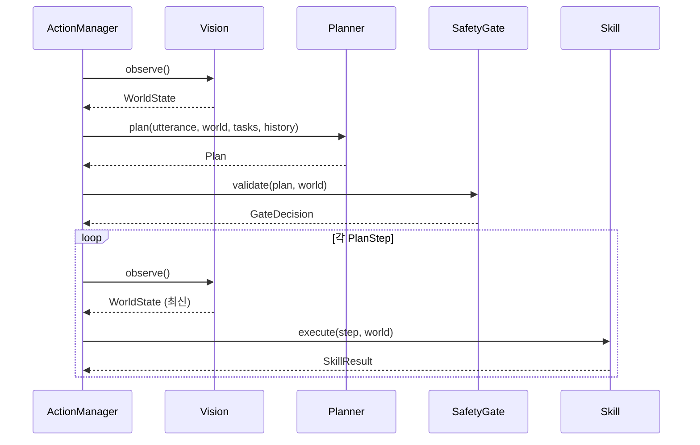

# 인터페이스 규격 (초안 v0.1)

> 상태: **초안 — 팀 합의 전** (Issue [#8](https://github.com/Gansoolgo/Thursday/issues/8)). 12/02 GO/NO-GO 회의에서 확정합니다.
> 목적: 4명이 모듈을 따로 개발해도 M3에서 그대로 합쳐지도록, 모듈 사이에 주고받는 **데이터 형식과 함수 모양**을 먼저 정합니다.
> 이 문서의 Python 코드는 규격을 설명하는 예시입니다. 실제 코드는 `app/core/types.py`에 이 문서와 똑같이 만듭니다.

## 목차
0. [공통 약속](#0-공통-약속)
1. [World State](#1-world-state)
2. [설정 파일: 물건·칸·작업 설명서](#2-설정-파일-물건칸작업-설명서)
3. [Plan: LLM 출력 형식](#3-plan-llm-출력-형식)
4. [Gate 판정](#4-gate-판정)
5. [Skill과 실행 결과](#5-skill과-실행-결과)
6. [사용 기록과 배치 최적화](#6-사용-기록과-배치-최적화)
7. [모듈 함수 규격](#7-모듈-함수-규격)
8. [실패 코드](#8-실패-코드)
9. [합의가 필요한 질문](#9-합의가-필요한-질문)

---

## 0. 공통 약속

| 항목 | 규칙 |
|---|---|
| 길이 단위 | **mm** (float) |
| 각도 단위 | **도(deg)** |
| 좌표계 | **작업대 좌표계 `table`**: 원점 = 로봇 베이스 중심 바로 아래 작업대 표면, x = 로봇 정면 방향, y = 로봇 기준 왼쪽, z = 위. 오른손 좌표계 |
| 픽셀 좌표 | 카메라 이미지 기준 (u, v), 왼쪽 위가 (0, 0). 모듈 밖으로는 내보내지 않고 Vision 안에서 `table`로 변환 |
| 시간 | `time.time()` 실수 초 (Unix time). 화면 표시만 사람이 읽는 형식 |
| ID | 소문자 + 숫자 + `_` (예: `resistor_220`, `S3`, `W1`, `H`) |
| 데이터 교환 | Python `dataclass` ↔ JSON 상호 변환 가능해야 함 (`to_dict()` / `from_dict()`) |
| 로그 | 한 줄에 JSON 하나(`.jsonl`), `logs/` 폴더 (Git 제외) |

## 1. World State

카메라로 본 **지금 이 순간의 작업대 상태**입니다. Vision이 만들고, 나머지 모듈은 읽기만 합니다.

```python
@dataclass
class ObjectInfo:
    id: str               # 인스턴스 ID, 예: "resistor_220_0"
    cls: str              # 물건 종류 = objects.yaml의 키, 예: "resistor_220"
    confidence: float     # 0.0~1.0 인식 신뢰도
    pose_mm: tuple[float, float, float]  # table 좌표 (x, y, z) 물건 중심
    yaw_deg: float | None # 놓인 방향, 모르면 None
    slot_id: str | None   # 들어 있는 칸, 칸 밖이면 None

@dataclass
class Slot:
    id: str               # "S1".."S9" 보관, "W1".."W4" 작업, "H" 전달
    zone: str             # "storage" | "work" | "handover"
    center_mm: tuple[float, float, float]
    occupied_by: str | None   # ObjectInfo.id 또는 None

@dataclass
class RobotState:
    state: str            # "IDLE" | "MOVING" | "HOLD" | "ESTOP" | "DISCONNECTED"
    calibrated: bool
    holding: str | None   # 그리퍼에 쥔 ObjectInfo.id

@dataclass
class SafetyState:
    estop: bool           # 비상 정지 눌림
    human_in_zone: bool   # 참고용. 이 값만으로 안전을 판단하지 않음

@dataclass
class WorldState:
    scene_id: str         # 프레임 ID, 예: "frame_000123"
    timestamp: float
    objects: list[ObjectInfo]
    slots: dict[str, Slot]
    robot: RobotState
    safety: SafetyState
    valid: bool           # 카메라·보정이 정상이라 믿을 수 있는 상태인지
```

**규칙**
- `confidence`가 기준값(초안 0.6) 미만인 물건은 `objects`에 넣지 않습니다. 기준값은 Vision 담당이 M1 결과로 정합니다.
- 같은 종류가 여러 개면 `id` 끝에 `_0`, `_1`을 붙입니다.
- 로봇이 움직이는 중에 찍은 프레임은 `valid=False`로 둡니다. 계획과 결과 확인에는 `valid=True`만 씁니다.

**JSON 예시**

```json
{
  "scene_id": "frame_000123",
  "timestamp": 1764147600.12,
  "objects": [
    {"id": "resistor_220_0", "cls": "resistor_220", "confidence": 0.93,
     "pose_mm": [180.0, 60.0, 5.0], "yaw_deg": null, "slot_id": "S2"}
  ],
  "slots": {
    "S2": {"id": "S2", "zone": "storage", "center_mm": [180.0, 60.0, 0.0], "occupied_by": "resistor_220_0"},
    "H":  {"id": "H", "zone": "handover", "center_mm": [220.0, -120.0, 0.0], "occupied_by": null}
  },
  "robot": {"state": "IDLE", "calibrated": true, "holding": null},
  "safety": {"estop": false, "human_in_zone": false},
  "valid": true
}
```
> 숫자는 설명용 가짜 값입니다. 실제 칸 좌표는 M1 실측 후 `config/slots.yaml`에 넣습니다.

## 2. 설정 파일: 물건·칸·작업 설명서

**범용성의 핵심**입니다. 새 작업을 추가할 때는 이 파일들만 바꾸고 엔진 코드는 고치지 않습니다.

### `config/objects.yaml` — 다룰 수 있는 물건

```yaml
resistor_220:
  display_name: 저항 220Ω
  aliases: [저항, 220옴, 빨간 저항]   # LLM이 사용자 말과 연결할 때 사용
  size_mm: [30, 20, 15]
  graspable: true
led_red:
  display_name: 빨간 LED
  aliases: [LED, 엘이디, 빨간 불]
  size_mm: [25, 25, 20]
  graspable: true
```

### `config/slots.yaml` — 칸 위치 (보정 결과)

```yaml
S1: {zone: storage, center_mm: [150, 100, 0]}
W1: {zone: work, center_mm: [250, 0, 0]}
H:  {zone: handover, center_mm: [220, -120, 0]}
```

### `tasks/<task_id>.yaml` — 작업 설명서

```yaml
task_id: led_lab
name: LED 회로 실습
domain: electronics          # electronics | education | assembly ...
required_objects: [breadboard, led_red, resistor_220, jumper_wires, battery_holder]
layout_hint: 저항은 LED 바로 옆 칸에 둔다   # 자연어, LLM이 참고만 함
```

**규칙:** `required_objects`의 모든 값은 `objects.yaml`에 있어야 합니다. 시작할 때 검사해서 없으면 실행하지 않습니다.

## 3. Plan: LLM 출력 형식

LLM은 아래 JSON **만** 출력합니다. OpenVINO GenAI의 JSON schema 제약 출력(`StructuredOutputConfig`)에 이 스키마를 그대로 넣습니다.

작은 모델이 틀리지 않도록 **평평한 구조**로 만들었습니다. Skill마다 인자 모양을 다르게 하지 않고, 쓰지 않는 칸은 `null`입니다.

```json
{
  "type": "object",
  "properties": {
    "decision": {"enum": ["execute", "ask", "reject"]},
    "goal": {"type": "string"},
    "task_id": {"type": ["string", "null"]},
    "steps": {
      "type": "array",
      "maxItems": 12,
      "items": {
        "type": "object",
        "properties": {
          "skill": {"enum": ["pick_place", "hand_over", "optimize_layout", "verify_result"]},
          "object_id": {"type": ["string", "null"]},
          "slot_id": {"type": ["string", "null"]}
        },
        "required": ["skill", "object_id", "slot_id"]
      }
    },
    "question": {"type": ["string", "null"]},
    "reason": {"type": ["string", "null"]}
  },
  "required": ["decision", "goal", "task_id", "steps", "question", "reason"]
}
```

| decision | 의미 | 함께 채우는 칸 |
|---|---|---|
| `execute` | 실행할 계획이 있음 | `steps` |
| `ask` | 모호해서 사용자에게 물어봄 | `question` (steps는 빈 배열) |
| `reject` | 할 수 없거나 위험함 | `reason` (steps는 빈 배열) |

**예시: "저항 줘" (후보가 하나일 때)**

```json
{"decision": "execute", "goal": "저항 전달", "task_id": null,
 "steps": [
   {"skill": "hand_over", "object_id": "resistor_220_0", "slot_id": null},
   {"skill": "verify_result", "object_id": "resistor_220_0", "slot_id": "H"}
 ],
 "question": null, "reason": null}
```

**규칙**
- 스키마는 **형식**만 보장합니다. 존재하는 물건인지, 칸이 비었는지 같은 **의미 검사는 Safety Gate가** 합니다.
- LLM에 넣는 입력: 사용자 말, World State 요약(물건 id·칸만), 등록된 작업 설명서 목록, Skill 목록. 좌표는 넣지 않습니다.

## 4. Gate 판정

```python
@dataclass
class GateDecision:
    verdict: str              # "OK" | "ASK" | "REJECT"
    reason_code: str | None   # 8장 실패 코드
    message: str              # 사용자에게 보여 줄 한국어 문장
    checked_plan: Plan | None # OK일 때 실행할 계획 (Gate가 바꾸지 않음)
```

**Safety Gate 검사 목록 (순서대로, 하나라도 걸리면 멈춤)**

| # | 검사 | 실패 시 |
|---|---|---|
| 1 | 비상 정지 눌림 / World State `valid=False` / 로봇 미보정 | REJECT |
| 2 | Plan이 스키마에 맞는가 | REJECT (`PLAN_SCHEMA`) |
| 3 | `skill`이 Registry에 있는가 | REJECT (`UNKNOWN_SKILL`) |
| 4 | `object_id`가 지금 World State에 있는가 | REJECT (`OBJECT_NOT_FOUND`) |
| 5 | 같은 종류가 여러 개인데 사용자가 특정하지 않았는가 | ASK (`AMBIGUOUS`) |
| 6 | 목표 칸이 존재하고 비어 있는가 | REJECT (`SLOT_OCCUPIED`) |
| 7 | 목표 좌표가 작업 가능 범위 안인가 | REJECT (`OUT_OF_REACH`) |
| 8 | 단계 수 ≤ 12, 재시도 예산 남음 | REJECT (`BUDGET_EXCEEDED`) |

LLM은 Gate 규칙을 바꿀 수 없습니다. 규칙은 코드와 `config/safety.yaml`에만 있습니다.

## 5. Skill과 실행 결과

```python
class Skill(Protocol):
    name: str
    def check_precondition(self, step: PlanStep, world: WorldState) -> str | None:
        """실행 가능하면 None, 아니면 실패 코드"""
    def execute(self, step: PlanStep, world: WorldState) -> SkillResult: ...

@dataclass
class SkillResult:
    status: str               # "SUCCESS" | "FAILED" | "UNAVAILABLE" | "HOLD"
    failure_code: str | None
    observations: dict        # 예: {"placed_slot": "H", "duration_s": 6.2}
    started_at: float
    finished_at: float
```

| Skill | 사용하는 칸 | 하는 일 | 성공 판정 |
|---|---|---|---|
| `pick_place` | object_id, slot_id | 물건을 집어 목표 칸에 놓음 | 행동 후 World State에서 물건이 목표 칸에 있음 |
| `hand_over` | object_id | 물건을 전달 위치 `H`에 놓음 | 물건이 `H`에 있음 |
| `optimize_layout` | 없음 | 배치 최적화를 돌려 pick_place 목록으로 펼침 | 배정표 생성 |
| `verify_result` | object_id, slot_id | 지정한 물건이 지정 칸에 있는지 확인 | 일치 |

`ask_user`는 Skill이 아니라 Plan의 `decision: "ask"`로 처리합니다.

### 로봇 하드웨어 계층 (Robotics 담당, mock 필수)

```python
class RobotArm(Protocol):
    def move_to(self, pose_mm: tuple[float, float, float], yaw_deg: float = 0.0,
                speed: float = 0.3) -> bool: ...   # speed: 0~1 비율
    def grip(self, close: bool) -> bool: ...
    def home(self) -> bool: ...
    def stop(self) -> None: ...                     # 즉시 정지, 항상 동작해야 함
    def state(self) -> RobotState: ...
```

`MockRobotArm`을 같이 만들어, 로봇이 없어도 다른 팀원이 전체 흐름을 테스트할 수 있게 합니다.

## 6. 사용 기록과 배치 최적화

### 사용 기록 `logs/usage.jsonl` (한 줄 = 한 사건)

```json
{"t": 1764147600.1, "event": "handed_over", "cls": "resistor_220", "task_id": "led_lab", "session": "s_001"}
{"t": 1764147650.4, "event": "task_started", "cls": null, "task_id": "led_lab", "session": "s_001"}
```

| event | 언제 |
|---|---|
| `task_started` / `task_finished` | 작업 시작·종료 |
| `prepared` | 준비 단계에서 꺼냄 |
| `handed_over` | 작업 중 건네줌 |
| `returned` | 정리로 보관 칸에 넣음 |

### 배치 최적화 입출력

```python
@dataclass
class LayoutRequest:
    objects: list[ObjectInfo]          # 정리할 물건
    free_slots: list[Slot]             # 쓸 수 있는 보관 칸
    usage_stats: dict[str, float]      # cls → 점수 (사용 빈도 등)
    next_task_id: str | None           # 다음에 할 작업 (있으면 가중치)

@dataclass
class LayoutResult:
    assignment: dict[str, str]         # ObjectInfo.id → Slot.id
    cost_before: float                 # 정리 전 예상 꺼내기 거리 합
    cost_after: float                  # 정리 후 예상 꺼내기 거리 합
    method: str                        # "usage_greedy" | "fixed_home" (비교용)
```

비교군 `fixed_home`(물건마다 정해진 자리)도 같은 형식으로 결과를 내서 바로 비교합니다. 비용 함수(거리를 무엇으로 볼지)는 #16에서 정합니다.

## 7. 모듈 함수 규격

| 모듈 | 함수 | 입력 → 출력 | 담당 |
|---|---|---|---|
| Vision | `observe()` | 없음 → `WorldState` | Vision |
| Vision | `pixel_to_table(u, v)` | 픽셀 → `(x, y, z)` mm | Vision |
| Planner | `plan(utterance, world, tasks, history)` | 사용자 말 등 → `Plan` | GenAI |
| SafetyGate | `validate(plan, world)` | → `GateDecision` | GenAI |
| LayoutOptimizer | `assign(request)` | `LayoutRequest` → `LayoutResult` | Robotics |
| Skill | `execute(step, world)` | → `SkillResult` | Robotics |
| ActionManager | `handle(utterance)` | 사용자 말 → 최종 응답 문장 (FSM 실행) | System |
| UsageLog | `append(event)`, `stats()` | 사건 기록 / 통계 | System |



## 8. 실패 코드

| 코드 | 의미 | 기본 대응 |
|---|---|---|
| `ESTOP` | 비상 정지 | 즉시 정지, 수동 재시작 |
| `STATE_INVALID` | 카메라·보정 이상 | HOLD |
| `PLAN_SCHEMA` | LLM 출력 형식 오류 | 1회 재생성 후 REJECT |
| `UNKNOWN_SKILL` | 등록 안 된 Skill | REJECT |
| `OBJECT_NOT_FOUND` | 물건이 안 보임 | 사용자에게 알림 |
| `AMBIGUOUS` | 후보 여러 개 | ASK |
| `SLOT_OCCUPIED` | 목표 칸이 차 있음 | 재계획 |
| `OUT_OF_REACH` | 작업 범위 밖 | REJECT |
| `GRASP_FAILED` | 집기 실패 | 재시도 (최대 2회) |
| `PLACE_MISMATCH` | 놓았는데 다른 칸에 있음 | 재시도 (최대 2회) |
| `TIMEOUT` | 동작 시간 초과 | 정지 후 HOLD |
| `BUDGET_EXCEEDED` | 단계·재시도 한도 초과 | HOLD |

## 9. 합의가 필요한 질문

12/02 회의에서 정할 것입니다. 괄호 안은 초안 제안입니다.

1. 좌표계 원점을 로봇 베이스로 할지, 작업대 모서리 마커로 할지 (로봇 베이스)
2. 칸 개수와 크기 (보관 9, 작업 4, 전달 1 — IK 실측 후 조정)
3. 인식 신뢰도 기준값 (0.6)
4. Plan에 좌표를 넣지 않고 칸 ID만 쓰는 방식에 동의하는지 (동의 — 좌표는 결정론적 코드가 계산)
5. 모듈 사이를 함수 호출로 할지, 프로세스를 나눠 통신할지 (단일 Python 프로세스 + 함수 호출. 필요할 때만 분리)
6. 재시도 횟수 (Skill당 2회, 계획당 재계획 1회)
