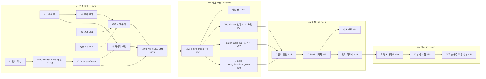

# 의존 관계 · 위험 · 대비책

> **📌 3줄 요약**
> - **핵심 경로(늦어지면 전체가 늦어지는 줄):** #3 로봇 연결 → #4 IK pick/place → #8 인터페이스 확정 → 12/03 공통 타입·Mock → Skill 구현 → 통합 → 12/17 마감. **로봇이 한 대**라는 게 가장 큰 병목입니다.
> - 위험 12개마다 **조기 신호**(이게 보이면 위험)와 **대비책**, **판단 날짜**를 정했습니다. 판단 날짜에 안 되면 고민하지 말고 대비책으로 갑니다.
> - 늦어지면 **줄이는 순서**도 미리 정했습니다. 음성 → 준비 → 건네기 → 마무리 정리 → 안전은 끝까지 지킵니다.
>
> 관련: [workflow.md](../workflow.md) GO/NO-GO · [decisions.md](decisions.md) · [스프린트 보드](https://github.com/orgs/Gansoolgo/projects/1)

---

## 1. 의존 관계

화살표 = "앞의 것이 끝나야 뒤의 것을 제대로 할 수 있음". 🔴 = 핵심 경로.

### 역할별 병렬 작업 (서로 기다리지 않는 줄)

| 역할 | M1 | M2 | M3 |
|---|---|---|---|
| Robotics | #3 → #4 (로봇 우선 사용) | Skill #10, 비상 정지 #13 | 정리 동작, 재시도 |
| Vision | #31 거치대·물건 → #5, #7 | 보정 모듈 #9, World State #14 | 단계 추정용 사건 감지 (H 사라짐, R 놓임) |
| GenAI | #6, #29 (로봇 없이 가능) | Safety Gate #11, 되묻기 #12 | 능동 제안 로직, 명령 세트 |
| System | #2, #31, #8, #30 | 공통 타입·Mock·샘플, 로그 형식, H3 시뮬레이션 | FSM #17, 대시보드 #18, 통합 |

- **GenAI·System은 로봇 없이 시작**할 수 있습니다. 로봇은 Robotics → Vision 순으로 먼저 씁니다.
- 12/03 **공통 타입·Mock**이 들어가면 4명 모두 로봇 없이도 개발·테스트할 수 있습니다. 그래서 이게 핵심 경로입니다.

## 2. 위험과 대비책

판단 날짜에 GO 기준을 못 넘으면 **그날 바로 대비책으로 전환**합니다. 더 붙잡고 있지 않습니다.

| # | 위험 | 가능성 | 영향 | 조기 신호 | 대비책 (Plan B) | 판단 |
|---|---|---|---|---|---|---|
| R1 | Windows에서 LeRobot·SO-101이 안 됨 | 중 | **큼** | 포트를 못 찾음, 캘리브레이션 오류 | ① 모터 SDK(feetech) 직접 제어 + 자체 IK ② WSL ③ 다른 PC | **11/28** #3 |
| R2 | IK pick/place가 부정확 | 중 | **큼** | 20회 중 실패 5회 이상, 놓은 위치가 매번 다름 | ① **티칭 방식**: 칸마다 원격조작으로 관절 자세를 저장해 두고 재생 (수업 때 해 본 방식) ② 지그·칸 축소·물건 키우기 | 12/01 #4 |
| R3 | 카메라-로봇 좌표 보정 오차가 큼 | 중 | 중 | 평균 오차 10mm 초과 | **칸 기반 인식**: 로봇은 R2의 저장 자세로 칸에 가고, 카메라는 "칸마다 무엇이 있나"만 판단 → 정밀 좌표 변환이 필요 없어짐 | 12/01 #5 |
| R4 | 언어 모델이 느리거나 계획이 틀림 | 중 | **큼** | 응답 5초 초과, 의미 정확도 18/20 미만 | ① 작은 모델·양자화 ② few-shot 예시 ③ **규칙 1차 + 언어 모델 보조**(자주 쓰는 명령은 규칙으로 즉시, 처음 보는 말만 모델) | 12/01 #6 |
| R5 | 한국어 음성 인식이 부정확 | 중 | 중 | 명령 인식 90% 미만, 소음에 약함 | ① 명령 문구를 짧게 정하기 ② 단일 지향 마이크 ③ **텍스트 입력 백업**(D-03) | 12/01 #29 |
| R6 | 노트북이 셋을 동시에 못 버팀 | 중 | 중 | 말 끝 → 계획 5초 초과, 인식 초당 10장 미만 | ① 인식 빈도 낮추기(동작 전후에만) ② 모델 축소 ③ **Pi + Hailo-8L로 인식 분리**(D-05) | 12/02 #30 |
| R7 | 조명·배경 때문에 인식이 흔들림 | 중 | 중 | 시간대별 정확도 차이 | ① 고정 조명 ② 클래스 축소 ③ 케이스에 ArUco 마커 붙여 보조 인식 | 12/01 #7 |
| R8 | 로봇 고장 (모터 과열·파손) | 하 | **큼** | 모터 발열, 이상한 소리, 위치 오차 증가 | ① 저속 운전·휴식 시간 ② **Leader 팔을 예비 부품으로** ③ 예비 모터 구매 검토 | 상시 |
| R9 | 로봇 한 대를 서로 쓰려고 대기 | **상** | 중 | Discord 예약이 겹침 | ① Mock 우선 개발 ② 로봇 시간표(오전 Robotics·오후 Vision 등) ③ 시험은 묶어서 한 번에 | 상시 |
| R10 | 통합이 늦어짐 (M3 지연) | 중 | **큼** | 12/12에 준비 종단 동작이 안 됨 | 아래 3장 **범위 줄이는 순서** 적용 | **12/12** |
| R11 | 역할·담당이 안 정해져 시작이 늦음 | 중 | 중 | 11/27까지 Issue 담당자 없음 | 추천 배정(#1 본문)대로 임시 시작, 회의에서 조정 | **11/27** |
| R12 | 발표 당일 시연 실패 | 중 | **큼** | 리허설 실패, 장소 조명·소음 다름 | ① **백업 영상** ② 시작 상태로 되돌리는 **리셋 절차** ③ 현장 조명 재보정 시간 확보 ④ 텍스트 입력 백업 | 12/17 #21 |

## 3. 늦어지면 줄이는 순서

**끝까지 지킬 것 (핵심):** 음성 명령 → 작업 준비 → 건네기 → 마무리 정리 + 안전(Safety Gate·비상 정지) + 측정 기록

| 순서 | 먼저 뺄 것 | 빼도 되는 이유 |
|---|---|---|
| 1 | 자동 모드 | 확인 모드만으로 능동성을 보여 줄 수 있음 |
| 2 | 음성 응답(TTS) | 화면 표시로 대체 |
| 3 | 사용자 체감 평가 | 선택 항목 |
| 4 | H3 실제 로봇 비교 | 시뮬레이션 결과로 대체 |
| 5 | 수시 정리 → 반납 칸 R만 지원 | 작업 구역 자동 판단은 빼고 R 신호만 |
| 6 | 교육 시나리오의 정리 단계 | 준비 단계만으로 범용성(H1) 증명 가능 |
| 7 | 다음 단계 먼저 제안 → 누락 알림만 | 능동성 최소한 유지 |

## 4. 날짜별 점검

| 날짜 | 점검 | 안 되면 |
|---|---|---|
| **11/27** | 역할·M1 담당 확정, 준비물 주문 | 추천 배정으로 임시 시작 |
| **11/28** | #3 Windows 로봇 연결 | R1 대비책 |
| **12/01** | #4·#5·#6·#7·#29 결과 → results-m1.md | 각 대비책 |
| **12/02** | GO/NO-GO 회의: #30 동시 부하, #8 인터페이스 확정 | R6 대비책, 인터페이스는 이날 무조건 확정 |
| **12/03** | 공통 타입·Mock·샘플 병합 | 그날 안에 끝내기 (모두가 기다림) |
| **12/09** | 각 모듈 단독 동작 (M2) | 범위 줄이기 검토 |
| **12/12** | 준비 종단 동작 | R10 → 범위 줄이기 적용 |
| **12/14** | 통합 완료 (M3) | 범위 줄이기 추가 적용 |
| **12/17** | **기능 동결**, 백업 영상, 최종 측정 | 동결 이후엔 버그 수정만 |
