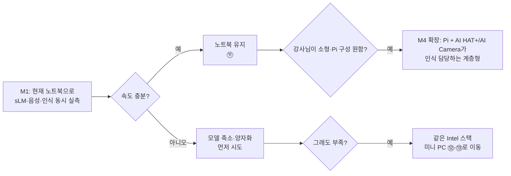

# 엣지 AI 장치 조사 (20종)

> **📌 3줄 요약**
> - **OpenVINO·Geti 모델을 고치지 않고 그대로 쓸 수 있는 건 Intel 계열뿐**입니다. 나머지는 전부 각 회사 도구로 모델을 다시 변환해야 합니다.
> - 가장 무거운 일은 **3~4B 소형 언어 모델(sLM)**. 외부 가속 모듈 중 이걸 돌리는 건 Hailo-10H·Axelera뿐이고, Hailo-10H는 3B에서 **Pi 5 CPU보다도 느렸습니다.**
> - 추천: **지금 노트북으로 시작**, 작게 만들고 싶으면 **같은 Intel 스택의 미니 PC·보드**, 강사님이 Pi를 원하면 **Pi + 비전 가속 모듈은 인식만 맡는 확장**으로.
>
> 조사일 2026-11-26. 성능·가격은 제조사 발표·리뷰·커뮤니티 측정 기준이며 **우리 장비에서 잰 값이 아닙니다.** **결정: 노트북으로 시작** ([decisions.md D-05](decisions.md)).

---

## 0. 우리가 돌려야 하는 것

| 일 | 무게 | 비고 |
|---|---|---|
| 음성 인식 (Whisper급, 한국어) | 중 | 버튼 누를 때만 |
| 물체 인식 (YOLO급) | 중 | 상시 |
| **소형 언어 모델 3~4B** → JSON 계획 | **무거움** | 명령마다. 장치 선택을 좌우 |
| 로봇 제어 (IK, USB 직렬) | 가벼움 | 상시 |

## 1. 소형 언어 모델(sLM) 속도 비교

생성 속도(tok/s, 초당 만들어 내는 글자 조각 수). JSON 계획 하나는 대략 50~150토큰이라, **10 tok/s면 5~15초, 25 tok/s면 2~6초** 정도 걸립니다(추정).

| 장치 | 1~1.5B | 3~4B | 출처 성격 |
|---|---|---|---|
| Raspberry Pi 5 CPU | 약 10~12 | 약 2~5 | 리뷰·커뮤니티 |
| Pi 5 + AI HAT+ 2 (Hailo-10H) | 약 6.7~8 | 2.6 (Llama 3.2 3B) | CNX, Geerling 리뷰 |
| RK3588 NPU (RKLLM) | — | 약 6.5~9 | Seeed 벤치마크 |
| Qualcomm QCS6490 | 약 12~13 | 확인 불가 | 커뮤니티 |
| **Intel Arrow Lake (우리 노트북 세대) iGPU** | — | **Qwen3-4B 약 24** (개발자 1명 측정, 데스크톱 칩) | OpenVINO GitHub 이슈 |
| Intel Lunar Lake (LattePanda Mu Ultra) | — | 약 25~41 (Intel 백서 검색 요약) | Intel |
| Intel Panther Lake NPU | 1B 약 65 | 확인 불가 | 보도 |
| AMD Ryzen AI 9 HX 370 NPU | — | Llama 3.2 3B 약 26 | FastFlowLM 자체 측정 |
| **NVIDIA Jetson Orin Nano Super** | — | **Llama 3.2 3B 약 43** | NVIDIA Jetson AI Lab |

> **Hailo-10H의 강점은 생성 속도가 아니라 첫 응답 시간**입니다 (96토큰 프롬프트 기준 약 2.0초 → 0.3초, Raspberry Pi 발표). 그리고 모델 실행을 맡아 Pi CPU를 비워 줍니다.

## 2. 가속 모듈 10종 (기존 장치에 붙이는 것)

| # | 모듈 | 성능 · 메모리 | 붙이는 곳 | 도구 · OpenVINO 호환 | 3~4B sLM | 가격 | 상태 |
|---|---|---|---|---|---|---|---|
| 1 | Pi AI HAT+ 13T (Hailo-8L) | 13 TOPS INT8 | Pi 5 전용 | ❌ Hailo 컴파일러(ONNX→HEF), **x86 Ubuntu·WSL2에서만** 변환 | ❌ | $70 | 판매 중 |
| 2 | Pi AI HAT+ 26T (Hailo-8) | 26 TOPS INT8 | Pi 5 전용 | ❌ 1과 같음 | ❌ | $110~132 | 판매 중 |
| 3 | Pi AI HAT+ 2 (Hailo-10H) | 40 TOPS INT4, 8GB | Pi 5 전용 | ❌ Hailo 전용, 미리 컴파일된 모델 목록만 | 🔶 가능하나 CPU보다 느림 | $130 발표 → 공식 $200 | 판매 중 |
| 4 | Pi AI Camera (Sony IMX500) | 카메라 안에서 추론 | 모든 Pi (CSI) | ❌ Sony 전용, YOLOv8n/11n만 | ❌ | $70 | 판매 중 |
| 5 | Hailo-8 M.2 | 26 TOPS | PC M.2 (Windows 실행 지원) | ❌ 변환은 x86 Linux | ❌ | 약 $180~300 | 판매 중 |
| 6 | Google Coral (Edge TPU) | 4 TOPS | USB / M.2 | ❌ TFLite 전용, 2022년 이후 갱신 없음 | ❌ | 확인 불가 | **사실상 단종(추정)** |
| 7 | **DeepX DX-M1** (국산) | 25 TOPS INT8, 4GB | M.2 · Pi 5 · x86, Windows 지원 | ❌ DXNN SDK (ONNX), **컴파일러는 시리얼 번호로 등록 필요** | ❌ 4GB라 어려움(추정) | DigiKey 한국 약 ₩215,000 | 판매 중 |
| 8 | Axelera Metis M.2 | 214 TOPS INT8, 1GB | M.2, Windows 지원 | ❌ Voyager SDK | 🔶 1B·3B 사전 컴파일본, 1GB라 3B 어려움 | €265 | 판매 중 |
| 9 | MemryX MX3 M.2 | 24 TOPS | M.2, Windows 지원 | ❌ 자체 컴파일러 | ❌ 비전 전용 | $149~ | 판매 중 |
| 10 | Intel NCS2 → 대체 Hailo-10H M.2 | NCS2는 단종 / Hailo-10H 40 TOPS INT4 | USB / M.2 | ❌ NCS2는 **OpenVINO 지원 종료** | Hailo-10H는 3번과 같음 | Hailo-10H M.2 $229~260 | NCS2 단종 |

**메모:** Intel Geti는 OpenVINO 외에 **ONNX로도 내보낼 수 있다고** 조사됐습니다. 그래서 위 모듈로 옮기는 것 자체는 가능하지만, 회사마다 양자화·컴파일 과정을 새로 익혀야 합니다. Geti의 ONNX 내보내기가 실제로 되는지는 M1에서 확인합니다.

## 3. 두뇌 보드 · 미니 PC 10종 (그 자체가 두뇌)

| # | 장치 | 칩 · AI 성능 · RAM | OS | 스택 · OpenVINO 호환 | 가격 | 메모 |
|---|---|---|---|---|---|---|
| 11 | **현재 노트북** Core Ultra 5 225H | CPU·iGPU·NPU 13 TOPS | Windows 11 | ✅ 그대로 | **보유** | 기준. 추가 비용 0 |
| 12 | **Intel Panther Lake 미니 PC** (ASUS NUC 16 Pro, Core Ultra 5 325 등) | NPU 50 TOPS, 플랫폼 최대 180 TOPS | Windows / Linux | ✅ 그대로. **Intel Physical AI 런타임의 공식 대상 세대** | 베어본 $559~ (RAM·SSD 별도), $999~1,700 | 작게 만들 때 1순위 |
| 13 | **AAEON UP Xtreme ARL** (산업용 보드) | **225H 탑재 가능 = 우리 노트북과 같은 칩**, 최대 97 TOPS | Windows / Ubuntu | ✅ 그대로 | 미공개 (약 $1,000+ 추정) | 코드 이전 위험 거의 0, GPIO 있음. 견적 필요 |
| 14 | LattePanda Mu Ultra (Lunar Lake) | NPU 40~47 TOPS, 16GB | Windows / Ubuntu | ✅ 그대로 | 키트 $683~783 | 작은 모듈형 |
| 15 | LattePanda Sigma 2 | Core Ultra X7 358H, 180 TOPS, 64GB | Windows / Ubuntu | ✅ 그대로 | $2,799 | 과함 |
| 16 | Radxa X4 (Intel N100) | NPU 없음 | Windows / Linux | 🔶 CPU·iGPU만 | 출시가 $60~80 | 3~4B sLM + 음성 동시엔 부족(추정) |
| 17 | NVIDIA Jetson Orin Nano Super | 67 TOPS, 8GB | Ubuntu만 | ❌ CUDA·TensorRT로 전환 | $249 | sLM·Whisper 가장 빠름. 단 **모델 전부 이전**, 8GB에 3개 모델 빠듯, **USB 직렬(CH34x) 드라이버 누락 보고** |
| 18 | NVIDIA Jetson Orin NX 16GB | 157 TOPS, 16GB | Ubuntu만 | ❌ 17과 같음 | 약 $1,200~1,280 | 비쌈 |
| 19 | AMD Ryzen AI 9 HX 370 미니 PC | NPU 50 TOPS | Windows / Linux | ❌ Ryzen AI SW (OpenVINO는 CPU만) | $999~1,700 | 성능 충분, 스택 전환 |
| 20 | Rockchip RK3588 · Qualcomm QCS6490 보드 | NPU 6 / 12 TOPS | Linux (Qualcomm은 Win IoT도) | ❌ RKNN·RKLLM / QNN | $60~440 (재고 불안) | 변환 부담 큼, 3주 일정에 위험 |
| 기준 | Raspberry Pi 5 16GB (CPU만) | NPU 없음 | Raspberry Pi OS | 🔶 OpenVINO ARM CPU | $305 | 3B 2~5 tok/s + 음성 동시면 실시간 대화 어려움(추정) |

## 4. 결론: 등급별 정리

| 등급 | 장치 | 언제 |
|---|---|---|
| **1. 그대로 쓴다** | ⑪ 현재 노트북 · ⑫ Panther Lake 미니 PC · ⑬ UP Xtreme ARL · ⑭ LattePanda Mu | **기본.** 코드·모델 수정 없이 장치만 바꿀 수 있음 |
| **2. 성능은 좋지만 갈아타야 함** | ⑰ Jetson · ⑲ Ryzen AI | 3주 일정에서는 비추천. 배운 스택을 버려야 함 |
| **3. 인식만 떼어 내는 보조** | ① AI HAT+ 13T · ④ AI Camera · ⑦ DeepX | 강사님이 Pi 구성을 원할 때 **계층형 확장**(Pi = 카메라·인식, 노트북 = 음성·sLM·계획) |
| **제외** | ⑥ Coral · ⑩ NCS2 · ⑨ MemryX(LLM 불가) · ⑳ RK3588·Qualcomm | 단종이거나 변환 부담 대비 이점 없음 |

### 추천 경로

## 5. 아직 모르는 것 (M1에서 확인)

- 우리 노트북(225H, 노트북용 iGPU)에서 **sLM + 음성 + 인식을 동시에** 돌렸을 때 실제 속도
- Geti 모델의 **ONNX 내보내기** 가능 여부 (다른 가속기로 옮길 때 필요)
- 한국어 JSON 계획 품질: Qwen3-4B, Phi-4-mini, **EXAONE 4.0 1.2B(LG, 도구 호출 지원)** 비교
- 한국어 음성 인식(Whisper small 다국어) 정확도와 지연

## 출처

**소형 언어 모델 속도:** [CNX AI HAT+ 2 리뷰](https://www.cnx-software.com/2026/01/20/raspberry-pi-ai-hat-2-review-a-40-tops-ai-accelerator-tested-with-computer-vision-llm-and-vlm-workloads/) · [Jeff Geerling AI HAT+ 2](https://jeffgeerling.com/blog/2026/raspberry-pi-ai-hat-2) · [computingforgeeks 엣지 LLM 비교](https://computingforgeeks.com/edge-llm-jetson-orin-vs-ai-hat-2-vs-hailo-10h/) · [pi5-hailo10h-llm-bench](https://github.com/rs3390/pi5-hailo10h-llm-bench) · [tinyweights Pi 5](https://tinyweights.dev/posts/run-llms-raspberry-pi-5/) · [OpenVINO NPU 컴파일러 이슈 #364](https://github.com/openvinotoolkit/npu_compiler/issues/364) · [Jetson AI Lab 벤치마크](https://www.jetson-ai-lab.com/archive/benchmarks.html) · [FastFlowLM Ryzen](https://fastflow-page.pages.dev/docs/benchmarks/llama3_results) · [Seeed RK LLM 벤치마크](https://sensecraft.seeed.cc/ai-lab/en/tutorials/rk/benchmark/llm)

**가속 모듈:** [Pi AI HAT+](https://www.raspberrypi.com/products/ai-hat/) · [Pi AI HAT+ 2](https://www.raspberrypi.com/products/ai-hat-plus-2/) · [Pi AI Camera](https://www.raspberrypi.com/products/ai-camera/) · [Ultralytics IMX500](https://docs.ultralytics.com/integrations/sony-imx500) · [Hailo-8 M.2](https://hailo.ai/products/ai-accelerators/hailo-8-m2-ai-acceleration-module/) · [Hailo DFC on WSL2](https://community.hailo.ai/t/how-to-install-the-hailo-dataflow-compiler-dfc-on-wsl2/2890) · [Coral](https://developers.google.com/coral) · [DeepX DX-M1 (DFRobot)](https://wiki.dfrobot.com/DFR1252) · [DeepX DigiKey 한국](https://www.digikey.kr/en/products/detail/deepx/DX-M1BNM5604/26858313) · [Axelera Metis M.2](https://store.axelera.ai/products/metis-m-2-card-the-most-performant-m-2-edge-ai-accelerator) · [MemryX MX3](https://memryx.ai/mx3/) · [Intel NCS2 지원 안내](https://www.intel.com/content/www/us/en/support/articles/000057224/boards-and-kits.html) · [Hailo-10H M.2](https://hailo.ai/products/generative-ai-accelerators/hailo-10h-m-2-generative-ai-acceleration-module/)

**보드·미니 PC:** [Jetson Orin Nano Super](https://www.tomshardware.com/tech-industry/artificial-intelligence/nvidia-launches-new-usd249-ai-development-board-that-does-67-tops) · [JetPack 6 USB 직렬 드라이버 이슈](https://forums.developer.nvidia.com/t/jetpack-6-0-doesnt-include-the-ttyusb-driver/302463) · [ASUS NUC 16 Pro](https://windowsreport.com/asus-nuc-16-pro-debuts-with-intel-panther-lake-and-up-to-180-tops-ai-power/) · [UP Xtreme ARL](https://www.cnx-software.com/2025/08/19/up-xtreme-arl-developer-board-delivers-up-to-97-tops-with-intel-core-ultra-7-265h-soc/) · [LattePanda Mu Ultra](https://linuxgizmos.com/x86-compute-module-features-intel-core-ultra-200v-with-up-to-115-tops/) · [LattePanda Sigma 2](https://www.cnx-software.com/2026/10/29/2600-lattepanda-sigma-2-single-board-server-features-180-tops-intel-core-ultra-x7-358h-soc-for-local-ai-applications/) · [Radxa X4 리뷰](https://www.tomshardware.com/raspberry-pi/radxa-x4-review) · [Ryzen AI 미니 PC](https://www.tomshardware.com/desktops/mini-pcs/ryzen-ai-9-hx-370-mini-pc-goes-on-sale-for-dollar999-dollar250-discount-from-the-regular-dollar1249-listing-price) · [Radxa Dragon Q6A](https://radxa.com/products/dragon/q6a) · [Raspberry Pi 5](https://www.raspberrypi.com/products/raspberry-pi-5/) · [Pi에서 OpenVINO](https://www.raspberrypi.com/news/run-ultralytics-yolo-on-raspberry-pi-with-openvino/)

**한국어 소형 모델·음성:** [EXAONE 4.0 1.2B](https://huggingface.co/LGAI-EXAONE/EXAONE-4.0-1.2B) · [OpenVINO GenAI 음성 인식](https://openvinotoolkit.github.io/openvino.genai/docs/use-cases/speech-recognition) · [Intel whisper-small OpenVINO](https://huggingface.co/Intel/whisper-small-openvino)
