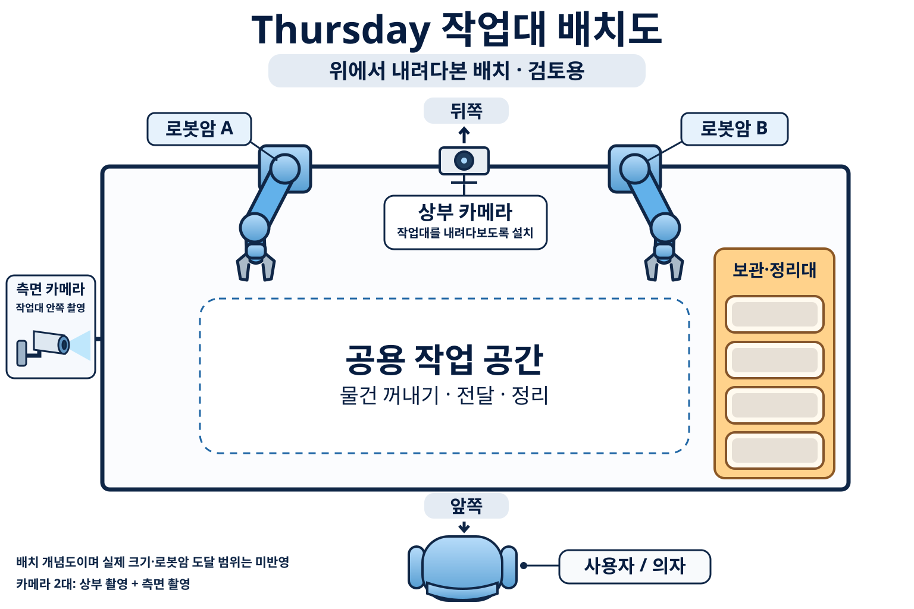

# 물건 · 작업대 구성 (초안 v0.2 — 방향 확정, 수치는 12/01 실측 후 확정)

> **📌 3줄 요약**
> - 시연 작업은 **블록 작업(D-14)** 과 **손수건 개기(D-07)**. 물건은 색 블록 6개 + 블록 트레이 + 손수건 + 방해 물건입니다.
> - 작업대는 **보관 9칸 · 트레이 자리 1 · 조립 줄 6칸(A1~A6) · 전달 1칸 · 반납 1칸**. 블록은 쌓지 않고 **조립 줄에 평면으로** 놓아 카메라가 전부 보게 합니다.
> - 수치(크기·거리·색)는 **가정**입니다. #4(IK 실측)·#5(보정) 결과로 12/01에 확정합니다.
>
> 결정 근거: [decisions.md](decisions.md) D-01(능동 보조·수시 정리), D-02(정리 융합), D-07(손수건 개기), D-08(손 위 또는 전달 칸 H), D-12(블록 트레이), D-14(블록 작업)
> 📖 낯선 말은 👉 [용어집](../glossary.md)

---

## 1. 설계 원칙

| 원칙 | 이유 |
|---|---|
| **블록은 쌓지 않고 평면으로 놓는다** | 위로 쌓으면 아래 블록이 카메라에 가려져 순서를 확인할 수 없음 |
| 실제 조립(브레드보드 등)은 하지 않는다. **블록으로 "과정 인식"을 보여 준다** | 개념 증명(D-09). 실제 조립 상태 인식은 장비를 보강하면 확장 가능하다고 발표에서 범위를 밝힘 |
| 블록은 **칸이 나뉜 트레이**에 담아 트레이 단위로 가져온다 (D-12) | 실제 작업장의 부품함 공급(키팅)과 같음. 트레이 안 블록 위치가 고정이라 좌표로 집기 쉬움 |
| 블록마다 **색이 달라** 번호를 색으로 구분한다 | 숫자 글씨보다 위에서 보는 카메라로 구분하기 쉬움 |
| 무게는 **가볍게** (목표 100g 이하, 실측 후 확정) | SO-101 가반하중 공식 수치 없음 → #4에서 확인. 블록 6개 + 트레이가 무거우면 속이 빈 3D 프린트·폼 블록 사용 |
| 사람 손 근처 동작은 조건을 걸어서만 | 전달은 건넴 구역에 멈춘 손이 있으면 손 위(저속, 몇 cm 위에서 놓기), 없으면 칸 H(D-08). 그 밖에 사람이 작업 구역에 손 넣을 땐 로봇 정지 |

## 2. 시연 물건

| ID (`cls`) | 이름 | 실물 | 크기 (가정) | 색 · 표시 | 쓰는 작업 |
|---|---|---|---|---|---|
| `block_blue` · `block_yellow` · `block_orange` · `block_red` · `block_green` · `block_white` | 색 블록 6개 | 정육면체 블록 (약 40mm, 가벼운 재질) | 작은 칸 | 6색 (가정) | 블록 작업 |
| `block_tray` | 블록 트레이 | 6칸으로 나뉜 얕은 트레이 | 큰 칸 | 단색 + 손잡이 | 블록 작업 |
| `handkerchief` | 손수건 | 사각 천 (크기·두께는 리더 팔 시험 후 결정) | 작업대 중앙 (칸 밖) | 단색 | 손수건 개기 (양팔) |
| `screwdriver` | 드라이버 모형 | 손잡이 달린 모형 (받침 위) | 큰 칸 | 보라 | **방해 물건** (어느 작업에도 필요 없음) |

> 인식: 블록은 "블록 한 클래스 + 색 분류"로 할지, 색마다 클래스를 둘지 #7에서 결정합니다. 보라는 드라이버라 블록 색에서 뺐습니다.
>
> 손수건은 물건 종류 인식에 더해 **상태 분류**(펴짐 / 모서리 하나 접힘 / 모서리 둘 접힘, 어느 모서리인지)가 필요합니다.
>
> **방해 물건을 넣는 이유:** 로봇이 "필요한 것만 골라 꺼내고, 필요 없는 건 안 꺼낸다"를 보여 주기 위해.

## 3. 작업대 배치 (위에서 본 그림, 가정)

> 아래 그림은 장비 위치 개념도(로봇암 2대 뒤쪽, 상부·측면 카메라, 사용자 앞쪽)이고, 칸 배치는 그 아래 글자 배치도가 기준입니다. 글자 배치도의 방향(로봇·사용자 위치)은 그림에 맞춰 12/01 실측 때 다시 그립니다.



<details open>
<summary>글자로 된 배치도 보기 (최신)</summary>

```text
             [ HP60C 깊이 카메라 2대: 상부 + 측면 (D-15) ]

   먼 쪽 ┌──────────────────────────────────────────────────────┐
         │  보관 구역 (S)                                        │
         │  ┌──────┐ ┌──────┐ ┌──────┐                          │
         │  │ S7 大│ │ S8 大│ │ S9 大│   ← 먼 줄 (접근 비용 큼)   │
         │  └──────┘ └──────┘ └──────┘                          │
         │  ┌───┐┌───┐┌───┐┌───┐┌───┐┌───┐                      │
         │  │S1 ││S2 ││S3 ││S4 ││S5 ││S6 │ ← 가까운 줄           │
         │  └───┘└───┘└───┘└───┘└───┘└───┘                      │
         │──────────────────────────────────────────────────────│
         │  트레이 자리 T        조립 줄 (A)        │ 건넴 구역    │
         │  ┌──────┐            ┌───┐ A6 (먼 쪽)    │  ┌───┐ ┌───┐ │
         │  │  T 大│            │A6 │             │  │ H │ │ R │ │
         │  └──────┘            │...│             │  └───┘ └───┘ │
         │                      │A1 │ A1 (사용자 쪽)│              │
   가까운 쪽└──────────────────────────────────────────────────────┘
              [ SO-101 로봇팔 ×2 ]                  [ 사용자 쪽 ]
```

</details>

| 구역 | 칸 | 크기 | 역할 |
|---|---|---|---|
| 보관 S | S1~S6 작은 칸 6, S7~S9 큰 칸 3 | 작은 칸 약 50×50mm, 큰 칸 약 90×60mm | 트레이·블록·손수건을 보관. 정리할 때 들어가는 곳. **가까운 줄일수록 접근 비용이 작음** |
| 트레이 자리 T | 1칸 (큰 칸) | 큰 칸 | "블록 작업 시작" → 로봇이 트레이를 여기로 가져다 둠 |
| 조립 줄 A | A1~A6 작은 칸 | 작은 칸 | 사용자가 블록을 놓는 곳. **A1(사용자에게 가장 가까움)부터 먼 쪽으로** 순서대로 |
| 전달 H | 1칸 | 작은 칸 | 손이 건넴 구역에 없을 때 블록을 놓는 곳 (D-08) |
| 반납 R | 1칸 | 작은 칸 | 사용자가 다 쓴 물건을 올려 두는 곳 → 수시 정리 신호 |

**접근 비용** = 로봇 시작 자세 → 칸 → 전달 칸 H까지의 이동 거리 (D-02 비용 함수의 거리). 칸 좌표가 정해지면 자동 계산합니다.

## 4. 작업 설명서 (초안)

`tasks/*.yaml`에 들어갈 내용입니다. **단계(steps)** 가 있어야 로봇이 지금 몇 단계인지 추정하고 다음 물건을 먼저 준비할 수 있습니다 (D-01).

### 블록 작업 A안 (D-14)

```yaml
task_id: block_a
name: 블록 작업 A안
domain: assembly
required_objects: [block_tray, block_blue, block_yellow, block_orange, block_red, block_green, block_white]
setup: {move: block_tray, to: T}          # 시작하면 트레이를 트레이 자리로
steps:                                    # 순서와 목표 칸 (색 순서는 가정)
  - {id: 1, uses: [block_blue],   target_slot: A1}
  - {id: 2, uses: [block_yellow], target_slot: A2}
  - {id: 3, uses: [block_orange], target_slot: A3}
  - {id: 4, uses: [block_red],    target_slot: A4}
  - {id: 5, uses: [block_green],  target_slot: A5}
  - {id: 6, uses: [block_white],  target_slot: A6}
# (안) 선후관계: 순서를 바꿔도 되는 단계를 적어 두면 '괜찮은 이탈'과 '문제 되는 이탈'을 구분할 수 있음
# after: {4: [3]}   # 예: 4번은 3번 뒤에만
```

> `target_slot`, `setup`, `after`는 지금 [interfaces.md](../interfaces.md)의 작업 설명서 형식에 없습니다. 쓰기로 하면 #8에서 interfaces.md와 같이 고칩니다.

### 손수건 개기 (양팔, D-07)

블록 작업과 달리 **단계가 고정되지 않습니다.** 초기 상태(어느 모서리가 접혔나)를 보고 로봇이 필요한 단계를 고릅니다.

```yaml
task_id: fold_cloth
name: 손수건 개기
domain: household
required_objects: [handkerchief]
initial_states: [flat, corner_folded_1, corner_folded_2]   # 임의로 구긴 상태는 범위 밖
steps:
  - {id: 1, desc: 접힌 모서리 펴기, skill: unfold_corner, when: 접힌 모서리가 있을 때만, repeat: 접힌 모서리 수만큼}
  - {id: 2, desc: 반 접기, skill: fold_half, repeat: 2}   # 횟수는 시험 후 확정
  - {id: 3, desc: 결과 확인, skill: verify_result}
```

> `unfold_corner`, `fold_half`는 새 Skill입니다 (티칭 또는 모방학습). 천 종류와 "펴기까지 할지"는 리더 팔로 시험한 뒤 정합니다.

## 5. 로봇이 상황을 아는 방법 (능동 보조의 근거)

카메라는 "어느 칸에 무엇이 있나"를 봅니다. 여기서 사건을 추론합니다.

| 카메라로 본 변화 | 의미 | 로봇의 능동 행동 (D-01) |
|---|---|---|
| 손이 작업 공간에 일정 시간 보임 | 사람이 작업하러 옴 | 대기 → 기본 자세 |
| H에 놓은 블록이 사라짐 / 손 위 전달 완료 | 사용자가 받음 | 다음 블록을 미리 집어 대기 |
| 조립 줄에 **기대한 색**이 놓임 | 단계 진행 | 말없이 다음 단계로 |
| 조립 줄에 **다른 색**이 놓임 (예: A2에 노랑 대신 주황) | 순서 이탈 | "노랑 차례인데 주황을 놓으셨어요. 이대로 갈까요?" → 답에 따라 노랑 제시 또는 순서 재계획 |
| 블록이 칸 사이에 걸쳐 있음 | 자리 어긋남 | "칸에 제대로 안 들어갔어요" |
| 오래 변화 없음 | 막힘 또는 쉬는 중 | 다음 블록을 전달 칸에 제시 (대기 시간은 넉넉히) |
| 트레이에 있어야 할 블록이 없음 | 누락 | 먼저 알림: "초록 블록이 없어요" |
| A1~A6이 모두 기대대로 채워짐 | 작업 끝 | "다 끝났어요. 정리할까요?" |
| 손이 일정 시간 안 보이고 정리 안 된 물건이 남음 | 사용자가 자리를 떠남 | 기다렸다가 남은 물건을 최적 배치(D-02)로 정리하고 종료 |
| R에 물건이 놓임 | 다 썼음 | **수시 정리** → 보관 칸으로 |
| 사용자가 말함 ("다 했어", "다음") | 단계 진행 (카메라 추정 보정) | 단계 갱신 |

- 순서 이탈 판단은 **결정론적 비교**(기대 칸 상태 ≠ 실제 칸 상태)로 하고, LLM은 안내 문장만 만듭니다.
- 손이 칸을 가리면 물건이 사라진 것처럼 보이므로, **몇 프레임 연속으로 같을 때만** 사건으로 인정합니다.
- 건넴 동작 외에 **사람 손이 작업 구역에 보이면 로봇은 움직이지 않습니다.** (안전의 1차 수단은 비상 정지·저속)
- 추정이 틀릴 수 있으므로 **확인 모드가 기본**입니다 (D-01).

## 6. 확인·확정할 것

| 항목 | 정하는 곳 | 기한 |
|---|---|---|
| 실제 작업 반경에 칸(S9·T·A6·H·R)이 다 들어가는지, 칸 좌표 | #4 IK 실측 | 12/01 |
| 그리퍼가 잡을 수 있는 폭·무게 → 블록·트레이 크기와 재질 확정, 트레이를 옮길 수 있는지 | #4 | 12/01 |
| 블록 색 6개가 조명 아래서 구분되는지, 클래스 방식 · 손 인식 · 손수건 상태 분류 | #7 | 12/01 |
| 손 위 전달: 깊이 카메라로 손 3D 위치 읽기, 건넴 구역 크기 | (Issue 필요) | M1 |
| HP60C 2대: Windows에서 Python으로 읽기, 두 대 적외선 간섭, 설치 거리 (D-15) | #5 + (Issue 필요) | M1 |
| 손수건: 천 종류, 모서리 집기 성공률, 양팔 동작 | (Issue 필요) | M1 |
| 단계 진행 신호·`target_slot`·선후관계를 interfaces.md에 반영 | #8 | 12/02 |
| 개념도(svg)와 칸 배치를 하나로 합치기 (로봇암 2대 기준 방향) | (담당 미정) | 12/01 실측 후 |
| 실물 구매·제작 목록 | [materials.md](materials.md) | 다음 |
