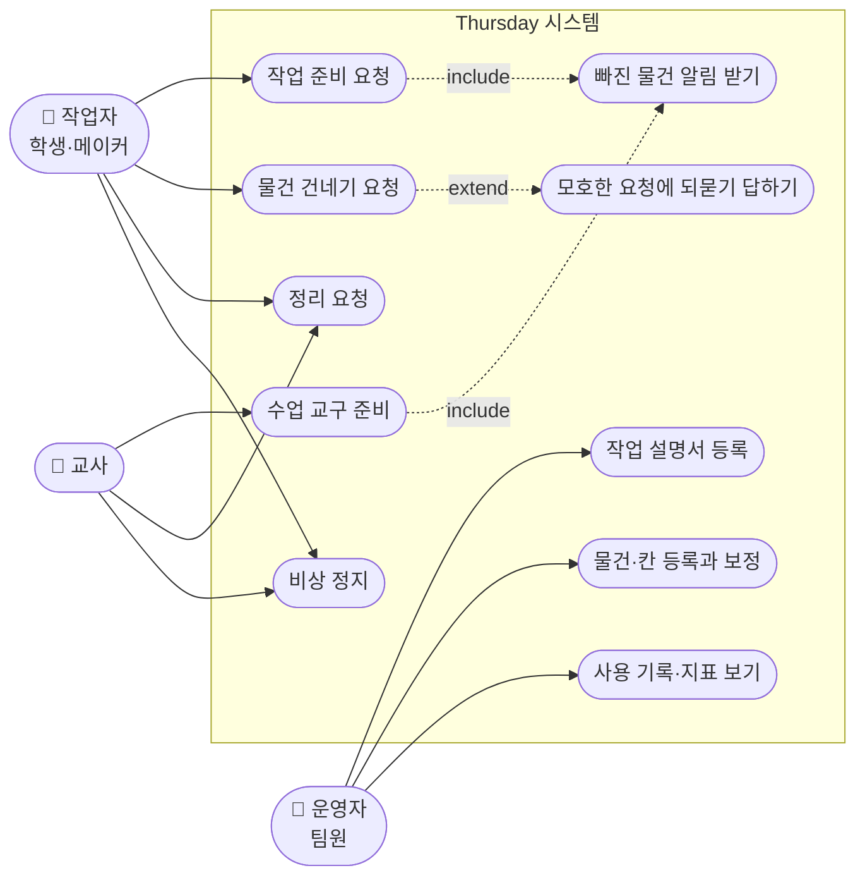

# 유즈케이스와 시나리오

> **📌 3줄 요약**
> - 사용자는 **작업자·교사·운영자** 3명, 핵심 유즈케이스는 준비·건네기·정리.
> - 시나리오 **S1~S5**: 준비, 보조, 정리, 손수건 개기(범용성), 시연 중 물건 변경(예외).
> - 초기 백로그는 **유저 스토리 US-01~12** (Must 9개). GitHub Issue와 번호가 연결됩니다.
> 📖 낯선 말은 👉 [용어집](glossary.md)

## 1. 유즈케이스 다이어그램

> Mermaid에는 UML 유즈케이스 전용 문법이 없어 flowchart로 표현했습니다. 둥근 사각형이 유즈케이스, 왼쪽이 액터입니다.



| 액터 | 설명 |
|---|---|
| 작업자 | 작업대에서 순서가 있는 조립 작업(시연은 블록 작업)을 하는 학생·메이커 |
| 교사 | 실습 수업용 교구를 준비하고 정리하는 사람 (범용성 시나리오) |
| 운영자 | 새 작업 설명서와 물건을 등록하고 카메라·로봇을 보정하는 팀원 |

## 2. 작업대 구성 (시연 기준)

```text
          [ 웹캠 (위에서 내려다봄) ]
 ┌──────────────────────────────────────────┐
 │  보관 구역 (칸 S1~S9)  │  작업 구역 (W1~W4) │
 │  자주 쓰는 것일수록     │                    │
 │  로봇·사용자에 가까운 칸 │  전달 위치 (H)     │
 └──────────────────────────────────────────┘
            [ SO-101 로봇팔 ]      [ 사용자 ]
```

- 물건은 가벼운 모형·부품 상자·손수건 등 ([workspace.md](plan/workspace.md) 2장).
- 사용자는 로봇이 멈춰 있을 때만 작업 구역에 손을 넣습니다.

## 3. 시나리오

### S1. 작업 준비 — "블록 작업 A안 시작"
1. 대기 중인 로봇이 작업 공간에 들어온 손을 보거나 "작업 시작" 음성을 듣고 기본 자세로 바뀐다.
2. 사용자가 작업 이름을 말하면 Planner가 작업 설명서(블록 작업 A안)에서 필요한 물건을 찾는다.
3. 블록 트레이를 보관 칸에서 트레이 자리(T)로 가져온다.
4. 트레이에 블록 6개가 다 있는지 확인하고, 없으면 "초록 블록이 없어요"라고 알린다.

### S2. 작업 중 보조 — 블록 순서대로 건네기 (D-14)
1. 로봇이 1번 블록을 집어 건넴 위치로 가져간다. 3~4초 안에 건넴 구역에 손이 멈춰 있으면 손 위에, 아니면 전달 칸(H)에 놓는다 (D-08).
2. 사용자가 조립 줄 A1(사용자 쪽)부터 먼 쪽으로 블록을 놓는다.
3. 기대한 색이 놓이면 로봇은 말없이 다음 블록을 미리 집어 준비한다.
4. **다른 색이 놓이면**(예: A2에 노랑 대신 주황) "노랑 차례인데 주황을 놓으셨어요. 이대로 갈까요?"라고 묻는다. "실수"면 노랑을 건네고, "이대로"면 남은 블록 기준으로 순서를 다시 짠다.
5. 사용자가 "파랑 줘"처럼 직접 요청하면 순서와 상관없이 건넨다. 후보가 여러 개면 되묻고, 등록되지 않은 물건이나 위험한 요청은 이유를 말하고 실행하지 않는다.

### S3. 작업 후 정리 — "정리해 줘" 또는 사용자가 떠남
0. 조립 줄이 다 채워지면 "다 끝났어요. 정리할까요?"라고 묻는다. 사용자가 직접 다 치우면 그대로 종료한다. 덜 치운 채 손이 일정 시간 안 보이면(자리를 떠남) 기다렸다가 아래 정리를 스스로 시작한다.
1. 작업 구역의 물건을 인식한다.
2. 배치 최적화가 사용 기록(사용 빈도, 같이 쓰인 물건, 다음 예정 작업)으로 각 물건의 칸을 정한다.
3. 로봇이 순서대로 옮기고, 결과를 카메라로 확인한다.
4. 정리 전후 "예상 꺼내기 거리"를 화면에 보여 준다.

### S4. 범용성 — 손수건 개기 (양팔, D-07)
1. 운영자가 손수건 작업 설명서와 새 동작 Skill(모서리 펴기, 반 접기)을 등록한다. **엔진 핵심(Planner·Safety Gate·Action Manager)은 고치지 않는다.**
2. 사용자가 모서리 한두 개가 접힌 손수건을 작업대에 놓고 "손수건 개 줘"라고 한다.
3. 로봇이 초기 상태(어느 모서리가 접혔나)를 판단해, 접힌 모서리가 있으면 먼저 펴고 없으면 바로 접는다.
4. 양팔로 두 번 정도 접고(횟수는 시험 후 확정), 카메라로 결과를 확인한다. 틀어졌으면 다시 하거나 알린다.
5. 임의로 구긴 상태처럼 범위 밖이면 "제가 펴기 어려워요, 펴 주세요"라고 말한다.

### S5. 예외 — 시연 중 물건을 빼거나 옮김
1. 로봇이 멈춘 상태에서 관람자가 물건 하나를 치운다.
2. 다음 행동 전 상태를 다시 확인해 변화를 감지한다.
3. 다시 계획하거나, 대안이 없으면 사용자에게 알리고 대기(HOLD)한다.

## 4. 유저 스토리 (초기 백로그)

> `US-xx`는 유저 스토리 번호입니다. 브랜치·PR·커밋에 붙여 추적합니다. 우선순위는 Must / Should / Could, 크기는 S / M / L.

| ID | 유저 스토리 | 인수 조건 | 우선순위 | 크기 |
|---|---|---|---|---|
| US-01 | 작업자로서 작업 이름을 말하면 필요한 물건이 꺼내져 있길 원한다, 준비 시간을 줄이려고 | 등록된 작업 설명서의 물건이 모두 작업 구역에 놓임 / 결과를 카메라로 확인 | Must | L |
| US-02 | 작업자로서 빠진 물건을 미리 알고 싶다, 작업 중 끊기지 않으려고 | 보관함에 없는 물건을 이름으로 알림 | Must | S |
| US-03 | 작업자로서 "○○ 줘"라고 하면 받고 싶다, 손이 바쁠 때 찾지 않으려고 | 요청한 물건이 전달 위치에 놓임 | Must | M |
| US-04 | 작업자로서 요청이 애매하면 로봇이 되묻길 원한다, 엉뚱한 물건을 받지 않으려고 | 후보가 2개 이상이면 실행 전 질문 | Must | S |
| US-05 | 작업자로서 위험하거나 불가능한 요청은 거절되길 원한다 | 미등록 물건·범위 밖 좌표·금지 동작은 실행 안 함, 이유 출력 | Must | S |
| US-06 | 작업자로서 "정리해 줘"라고 하면 다음에 쓰기 좋게 정리되길 원한다 | 사용 기록 기반으로 칸 배정 후 이동 / 정리 전후 거리 비교 표시 | Must | L |
| US-07 | 운영자로서 새 작업을 설명서 텍스트만으로 추가하고 싶다, 범용성을 위해 | 엔진 코드 수정 없이 새 작업 수행 / 추가 시간 기록 | Must | M |
| US-08 | 작업자로서 언제든 로봇을 멈출 수 있길 원한다 | 비상 정지 입력 시 즉시 정지, 재시작은 수동 확인 후 | Must | S |
| US-09 | 운영자로서 카메라 좌표와 로봇 좌표를 맞추고 싶다 | 보정 후 칸 중심 오차 측정·기록 | Must | M |
| US-10 | 운영자로서 성공률·지연·이동 거리 같은 지표를 보고 싶다, 발표 근거를 위해 | 시험마다 로그 저장, 요약 표 출력 | Should | M |
| US-11 | 작업자로서 말로 명령하고 싶다 | 음성 인식(로컬)으로 텍스트 입력 대체 | Could | M |
| US-12 | 운영자로서 특정 동작을 모방학습(ACT)으로 바꿔 비교하고 싶다 | IK 방식과 성공률 비교표 | Could | L |
