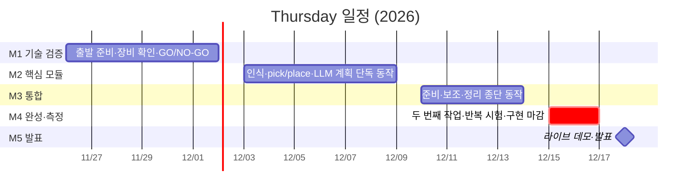

# 작업 방식

애자일 방식으로 진행합니다. 처음에 **출발 준비**를 한 번 하고, 이후에는 **2~3일 스프린트**를 반복합니다.

## 1. 일정과 Milestone

| Milestone | 기간 | 완료 조건 |
|---|---|---|
| M1 기술 검증 | 11/26 ~ 12/02 | 장비 사양 확인, 기술 검증 항목마다 GO/NO-GO 판정 기록, 역할 확정 |
| M2 핵심 모듈 | 12/03 ~ 12/09 | 인식·좌표 변환 / IK pick/place / LLM JSON 계획·Safety Gate가 각각 단독 테스트 통과 |
| M3 통합 | 12/10 ~ 12/14 | 텍스트 명령 → 계획 → 검증 → 실행 → 확인으로 준비·보조·정리 동작 |
| M4 완성·측정 | 12/15 ~ 12/17 | 교육 시나리오(두 번째 작업) 시연, 반복 시험 기록, 백업 영상. **12/17 구현 마감(기능 동결)** |
| M5 발표 | 12/18 | 라이브 데모 |

## 2. M1 기술 검증 (GO/NO-GO)

수치는 제안이며 첫 측정 후 팀이 확정합니다.

| 항목 | GO 기준 (안) | 안 되면 |
|---|---|---|
| Windows·LeRobot | 2일 안에 Windows에서 SO-101 연결(COM 포트)·캘리브레이션·원격조작 성공 | LeRobot 대신 모터 직접 제어(feetech SDK) + 자체 IK, 또는 WSL·다른 PC 검토 |
| IK pick/place | 정해진 칸 사이 20회 중 16회 이상 성공, 보정 오차 약 10mm 이하 | 지그 사용, 칸 수 축소 |
| 로컬 LLM | 목표 20개에 대해 JSON 스키마 유효, 응답 수 초 이내 | 더 작은 모델, 명령 문법 고정 |
| 물체 인식 | 6종을 OpenVINO로 추론, 작업 조명에서 안정 인식 | 클래스 축소, 조명 고정 |
| ACT (선택) | 단일 동작 50 에피소드 학습 후 성공률 측정 | 비교 실험으로만 보고 |

## 3. 스프린트

| 단계 | 하는 일 |
|---|---|
| 계획 | 백로그(Issue)에서 이번 스프린트에 끝낼 것을 고르고 담당 지정 |
| 구현 | Issue마다 브랜치, 단위 테스트 |
| PR·리뷰 | 다른 팀원 1명 이상 리뷰 후 Merge |
| 통합·시연 | 스프린트 끝에 실제 장비로 시연 |
| 회고 | 잘된 점 / 아쉬운 점 / 다음에 바꿀 점 한두 줄 |

## 4. 브랜치·커밋 규칙

- `main`은 항상 실행 가능한 상태를 유지합니다. main에 직접 push하지 않습니다(첫 커밋 제외).
- Issue 하나당 브랜치 하나: `feature/US-03-hand-over`, `fix/12-calib-offset`
- 커밋 메시지에 스토리·Issue 번호: `US-03: hand_over Skill 추가 (#7)`
- PR은 리뷰 1명 이상 + 테스트 통과 후 Merge.
- 비밀값(API 키 등)과 큰 모델 파일은 커밋하지 않습니다.

## 5. 완료 기준 (DoD)

아래를 모두 만족해야 Issue를 닫습니다.

- [ ] 유저 스토리의 인수 조건을 만족한다.
- [ ] 단위 테스트(하드웨어는 mock)가 있고 통과한다.
- [ ] 실제 장비가 필요한 기능은 저속·제한 동작으로 먼저 시험했다.
- [ ] 다른 팀원의 리뷰를 받았다.
- [ ] 비밀값·개인정보가 코드·로그·커밋에 없다.
- [ ] 인터페이스·흐름이 바뀌었으면 [architecture.md](architecture.md) 다이어그램도 고쳤다.
- [ ] 알려진 문제와 제약을 Issue나 문서에 남겼다.

## 6. 백로그 관리

- GitHub Issues에 유저 스토리(`US-xx`)와 작업을 등록하고 Milestone에 연결합니다.
- 라벨: `vision`, `genai`, `robotics`, `system`, `docs`, `spike`(기술 검증)
- 진행 상황은 Milestone 진행률로 확인합니다.
