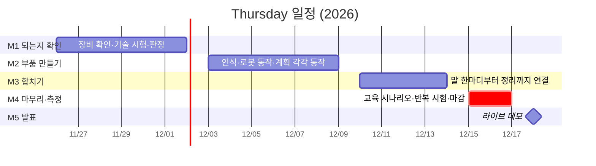
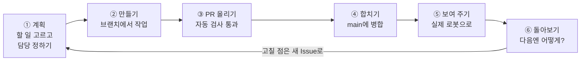

# 일하는 방식 · 일정

> **📌 3줄 요약**
> - **2~3일씩 끊어서** 만들고 → 보여 주고 → 고치기를 7번 반복합니다. 큰 마감은 5개(M1~M5), **12/17 구현 마감**.
> - 할 일은 GitHub **Issue**(할 일 카드)로, 진행 상황은 **[스프린트 보드](https://github.com/orgs/Gansoolgo/projects/1)** 로 봅니다.
> - **12/02**에 "각 기술이 진짜 되나?"를 판정하고(GO/NO-GO), 그 결과로 다음 계획을 확정합니다.
>
> 낯선 말이 나오면 👉 [용어집](glossary.md)

---

## 0. 한 문장으로

> 📚 **3주 동안 시험 공부하듯이** 합니다. 계획을 한 번에 다 짜지 않고, **2~3일 공부 → 모의고사 → 약한 부분 보충**을 반복합니다.

이 방식을 **애자일**이라고 부르고, 2~3일 한 묶음을 **스프린트**라고 부릅니다.

## 1. 일정

### 큰 마감 5개 (Milestone)

| 마감 | 기간 | 끝났다고 보는 조건 |
|---|---|---|
| **M1 되는지 확인** | 11/26 ~ 12/02 | 장비 확인, 기술마다 "된다/안 된다" 판정 기록, 역할 확정 |
| **M2 부품 만들기** | 12/03 ~ 12/09 | 물체 인식 · 로봇 집기/놓기 · 언어 모델 계획 · 안전 검사가 **각각 따로** 동작 |
| **M3 합치기** | 12/10 ~ 12/14 | 말 한마디 → 계획 → 검사 → 로봇 동작 → 결과 확인까지 **이어서** 동작 |
| **M4 마무리·측정** | 12/15 ~ 12/17 | 손수건 개기(두 번째 작업) 시연, 반복 시험 기록, 백업 영상. **12/17 이후 새 기능 없음** |
| **M5 발표** | 12/18 | 라이브 데모 |

### 2~3일 묶음 7개 (스프린트)

| 묶음 | 기간 | 목표 | 마감 |
|---|---|---|---|
| S1 | 11/26 ~ 11/28 | 노트북에 로봇 연결, 장비 확인, 역할 정하기 | M1 |
| S2 | 11/29 ~ 12/02 | 나머지 기술 시험 → **12/02 판정 회의** | M1 |
| S3 | 12/03 ~ 12/05 | 각자 맡은 부품 만들기 (전반) | M2 |
| S4 | 12/06 ~ 12/09 | 각자 맡은 부품 만들기 (후반) | M2 |
| S5 | 12/10 ~ 12/12 | 합치기: 준비 · 건네기 | M3 |
| S6 | 12/13 ~ 12/14 | 합치기: 정리 · 실패 복구 | M3 |
| S7 | 12/15 ~ 12/17 | 손수건 개기 통합, 반복 시험, **12/17 마감** | M4 |

> 손수건 개기는 모방학습(시범 수집 → GPU 서버 학습)이 필요할 수 있어 M4에 시작하면 늦습니다. **M1부터 별도 줄기로** 천 집기·양팔 동작을 시험하고, M4에는 통합만 합니다 (D-07).

## 2. 12/02 판정: "이 기술, 진짜 되나?" (GO/NO-GO)

M1은 **"되는지 짧게 시험해 보는 기간"** 입니다. 각 시험에 **통과 기준**을 정해 두고, 못 넘으면 고민하지 않고 **준비해 둔 다른 방법(Plan B)** 으로 바꿉니다.

> 📚 "모의고사 70점 넘으면 이 문제집 계속, 아니면 인강으로 바꾸기"

통과 기준 숫자는 **제안(안)** 이고, 처음 재 본 뒤 팀이 확정합니다. 시험별 자세한 내용은 각 Issue에 있습니다.

| Issue | 무엇을 시험하나 | 통과 기준 (안) | 안 되면 | 기한 |
|---|---|---|---|---|
| [#3](https://github.com/Gansoolgo/Thursday/issues/3) | Windows 노트북에 로봇 연결 | 연결 · 보정 · 원격조작 성공 | 모터 직접 제어, WSL, 다른 PC | **11/28** |
| [#4](https://github.com/Gansoolgo/Thursday/issues/4) | 로봇이 물건을 집어 옮기기 | 20번 중 16번 이상 성공, 놓은 위치 오차 약 1cm 이하 | 자세 저장 방식(티칭), 칸 줄이기 | 12/01 |
| [#5](https://github.com/Gansoolgo/Thursday/issues/5) | 카메라 위치 ↔ 로봇 위치 맞추기 | 평균 오차 약 1cm 이하 | 마커 추가, 칸 키우기 | 12/01 |
| [#6](https://github.com/Gansoolgo/Thursday/issues/6) | 언어 모델이 말을 할 일 목록으로 | 명령 20개 중 18개 정확, 5초 이내 | 더 작은 모델, 예시 추가 | 12/01 |
| [#7](https://github.com/Gansoolgo/Thursday/issues/7) | 카메라로 물건 알아보기 | 물건별 90% 이상, 0.1초 이내 | 물건 줄이기, 조명 고정 | 12/01 |
| [#29](https://github.com/Gansoolgo/Thursday/issues/29) | 한국어 음성 알아듣기 | 명령 90% 이상, 말 끝나고 1.5초 이내 | 명령 문구 고정, 키보드 입력 | 12/01 |
| [#30](https://github.com/Gansoolgo/Thursday/issues/30) | **위 셋을 노트북에서 동시에** | 말 끝 → 계획까지 평균 5초 이내 | 모델 줄이기 → 라즈베리파이 + Hailo로 나누기 | 12/02 |
| [#8](https://github.com/Gansoolgo/Thursday/issues/8) | 모듈끼리 주고받는 형식 확정 | 회의에서 합의 | — | 12/02 |
| — | (선택) 로봇 동작 학습(ACT) | 50번 시범 학습 후 성공률 | 비교용으로만 | 여유 있을 때 |

결과는 `docs/plan/results-m1.md` 한 곳에 모읍니다.

## 3. 2~3일 묶음(스프린트) 한 번은 이렇게

| 언제 | 무엇을 | 시간 | 📚 비유 |
|---|---|---|---|
| 첫날 | **① 계획**: 보드에서 이번에 끝낼 Issue를 고르고 담당자를 정함 | 15분 | "이번엔 1~3단원" |
| 매일 | **데일리**: Discord에 한 줄 — 어제 한 것 / 오늘 할 것 / 막힌 것 | 1분 | 스터디 출석 체크 |
| 중간 | **② ~ ④ 만들고 합치기**: [협업 규칙](../CONTRIBUTING.md) 순서대로 | — | 공부 |
| 마지막 날 | **⑤ 보여 주기**: 합친 것을 실제 로봇으로 돌려 봄 | 20분 | 모의고사 |
| 마지막 날 | **⑥ 돌아보기(회고)**: 잘된 점 / 아쉬운 점 / 다음에 바꿀 점 | 5분 | "아침 공부가 낫더라" |

> 맡은 일을 **어떻게** 만들지(어떤 AI를 쓸지 등)는 각자 자유입니다. 팀이 맞추는 건 **Issue · 브랜치 · PR · 완료 기준 · 주고받는 데이터 형식**뿐입니다.

### 애자일 용어 ↔ GitHub 기능

| 애자일에서 부르는 말 | 쉬운 뜻 | GitHub에서 |
|---|---|---|
| 백로그 | 할 일 전체 목록 | [Issues](https://github.com/Gansoolgo/Thursday/issues) |
| 유저 스토리 | "작업자로서 ○○하고 싶다" | `US-xx` Issue |
| 인수 조건 | "다 했다"고 인정하는 기준 | Issue ⑤칸 체크박스 |
| 칸반 보드 | 할 일 / 하는 중 / 끝남 | [스프린트 보드](https://github.com/orgs/Gansoolgo/projects/1) |
| 증분 | 이번에 새로 돌아가게 된 것 | main에 합쳐진 PR |
| 완료 기준(DoD) | 모든 일에 공통인 "끝"의 조건 | PR 체크리스트 + 자동 검사(CI) 통과 |
| 벨로시티 | 2~3일에 실제로 끝낸 양 | 묶음마다 닫은 Issue 수 |

더 많은 용어는 [용어집](glossary.md)에 있습니다.

## 4. 브랜치 · 커밋 규칙 (요약)

자세한 방법은 [협업 규칙](../CONTRIBUTING.md)과 [Git 가이드](git-guide.md)에 있습니다.

- **main(원본)에 바로 올리지 않습니다.** 항상 브랜치(복사본)에서 작업하고 PR로 합칩니다.
- Issue 하나 = 브랜치 하나: `feature/US-03-hand-over`, `fix/12-calib-offset`
- 커밋 메시지에 번호: `US-03: hand_over Skill 추가 (#10)`
- 자동 검사(CI)가 초록이면 합칩니다. **공통 파일 · 로봇 · 언어 모델**을 바꾼 PR만 팀원 1명이 먼저 봅니다.
- 비밀번호·키와 큰 모델 파일은 올리지 않습니다.

## 5. 완료 기준 — "다 했다"의 조건

아래를 모두 만족해야 Issue를 닫습니다. 같은 내용이 [PR 템플릿](../.github/pull_request_template.md)에 체크박스로 나옵니다.

> 📚 "문제를 풀었다"가 아니라 "**채점까지 했다**"가 끝입니다.

- [ ] Issue의 완료 조건(⑤칸)을 만족한다.
- [ ] 시험 코드가 있고 통과한다 (로봇·카메라는 가짜(mock)로 시험). **자동 검사 통과.**
- [ ] 실제 로봇이 필요한 기능은 **천천히, 좁은 범위로** 먼저 시험했다.
- [ ] 공통 파일 · 로봇 · 언어 모델을 바꿨다면 팀원 1명이 확인했다.
- [ ] [주고받는 데이터 형식](interfaces.md)을 지켰다 (바꿨다면 문서도 같이 고쳤다).
- [ ] 비밀번호·개인정보·큰 모델 파일이 없다.
- [ ] 흐름이 바뀌었으면 [구조 그림](architecture.md)도 고쳤다.
- [ ] 알려진 문제를 Issue나 문서에 적었다.

## 6. 할 일 목록(백로그) 관리

- 새 할 일은 **Issue 템플릿**(유저 스토리 / 작업·기술 시험 / 버그)으로 만들고 마감(Milestone)에 연결합니다.
- 라벨: `story`(사용자 기능), `spike`(되는지 시험), `bug`, 역할별 `vision` · `genai` · `robotics` · `system`, `docs`
- 무엇을 먼저 할지는 묶음 첫날 계획 회의에서 정합니다. 필요 없어진 Issue는 지우지 말고 이유를 적고 닫습니다.

## 7. 돌아보기 기록 (회고)

묶음 마지막 날 한 줄씩 추가합니다. **같은 문제가 두 번 나오면** 완료 기준이나 [AI 규칙](../AGENTS.md)에 규칙으로 옮깁니다.

| 묶음 | 잘된 점 | 아쉬운 점 | 다음에 바꿀 점 |
|---|---|---|---|
| S1 | | | |
