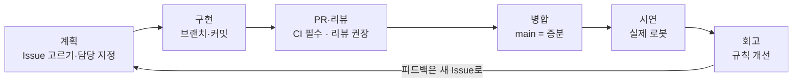

# 작업 방식

> **📌 3줄 요약**
> - **2~3일 스프린트** 7번(S1~S7), 큰 단계는 Milestone M1~M5. 12/17 구현 마감.
> - 애자일 개념은 GitHub 기능으로: 백로그=Issues, 증분=병합된 PR, DoD=PR 체크리스트+CI.
> - 12/02에 **GO/NO-GO**: 각 기술이 되는지 보고 M2 계획을 확정.

애자일 방식으로 진행합니다. 처음에 **출발 준비**를 한 번 하고, 이후에는 **2~3일 스프린트**를 반복합니다.

## 1. 일정과 Milestone

| Milestone | 기간 | 완료 조건 |
|---|---|---|
| M1 기술 검증 | 11/26 ~ 12/02 | 장비 사양 확인, 기술 검증 항목마다 GO/NO-GO 판정 기록, 역할 확정 |
| M2 핵심 모듈 | 12/03 ~ 12/09 | 인식·좌표 변환 / IK pick/place / LLM JSON 계획·Safety Gate가 각각 단독 테스트 통과 |
| M3 통합 | 12/10 ~ 12/14 | 텍스트 명령 → 계획 → 검증 → 실행 → 확인으로 준비·보조·정리 동작 |
| M4 완성·측정 | 12/15 ~ 12/17 | 교육 시나리오(두 번째 작업) 시연, 반복 시험 기록, 백업 영상. **12/17 구현 마감(기능 동결)** |
| M5 발표 | 12/18 | 라이브 데모 |

## 2. M1 기술 검증 (GO/NO-GO)

수치는 제안이며 첫 측정 후 팀이 확정합니다. 각 항목의 상세 명세(입력·출력, 완료 조건)는 Issue에 있습니다.

| Issue | 항목 | GO 기준 (안) | 안 되면 | 기한 |
|---|---|---|---|---|
| [#3](https://github.com/Gansoolgo/Thursday/issues/3) | Windows·LeRobot | Windows에서 SO-101 연결·캘리브레이션·원격조작 성공 | 모터 SDK 직접 제어 + 자체 IK, WSL, 다른 PC | **11/28** |
| [#4](https://github.com/Gansoolgo/Thursday/issues/4) | IK pick/place | 20회 중 16회 이상 성공, 놓은 위치 오차 약 10mm 이하 | 지그, 칸 축소, 물건 키우기 | 12/01 |
| [#5](https://github.com/Gansoolgo/Thursday/issues/5) | 카메라-로봇 보정 | 검증점 평균 오차 10mm 이하 | ArUco 마커, 칸 키우기 | 12/01 |
| [#6](https://github.com/Gansoolgo/Thursday/issues/6) | 소형 언어 모델 계획 | 한국어 명령 20개 중 18개 의미 정확, 응답 5초 이내 | 작은 모델, few-shot, 문법 고정 | 12/01 |
| [#7](https://github.com/Gansoolgo/Thursday/issues/7) | 물체 인식 | 클래스별 정확도 90% 이상, 추론 100ms 이내 | 클래스 축소, 조명 고정 | 12/01 |
| [#29](https://github.com/Gansoolgo/Thursday/issues/29) | 한국어 음성 인식 | 명령 인식 90% 이상, 말 끝 후 1.5초 이내 | 모델 변경, 문구 고정, 텍스트 백업 | 12/01 |
| [#30](https://github.com/Gansoolgo/Thursday/issues/30) | **동시 실행 부하** | 말 끝 → 계획 완성 평균 5초 이내, 인식 초당 10장 이상 | 모델 축소 → Pi + Hailo-8L로 인식 분리 (D-05) | 12/02 |
| [#8](https://github.com/Gansoolgo/Thursday/issues/8) | 인터페이스 확정 | 9장 질문 결정, 리뷰 승인 | — | 12/02 |
| — | ACT (선택) | 단일 동작 50 에피소드 학습 후 성공률 측정 | 비교 실험으로만 보고 | 여유 시 |

결과는 `docs/plan/results-m1.md` 한 곳에 모읍니다.

## 3. 애자일을 GitHub로 하는 법

애자일의 핵심은 **처음부터 다 정하지 않고, 짧게 만들어 보고, 자주 보여 주고, 피드백으로 방향을 고치는 것**입니다. 우리 팀은 애자일의 각 개념을 아래 GitHub 기능으로 실행합니다.

| 애자일 개념 | 뜻 | 우리 팀에서 쓰는 GitHub 기능 |
|---|---|---|
| 제품 백로그 | 앞으로 할 일 전체를 우선순위대로 모은 목록 | **Issues** 전체 + 라벨(`story`, `spike`, 역할별) |
| 유저 스토리 | "○○로서 ○○하고 싶다, 왜냐하면 ○○" 형식의 요구사항 | **유저 스토리 Issue 템플릿** (`US-xx`) |
| 인수 조건 | 그 스토리를 "됐다"고 인정하는 구체적 조건 | Issue 본문의 체크박스 |
| 릴리스 목표 | 큰 단계의 목표와 마감 | **Milestone** M1~M5 |
| 스프린트 | 2~3일 안에 동작하는 결과를 만드는 반복 단위 | 스프린트 계획 회의에서 고른 Issue + 담당자 지정 |
| 스프린트 보드 | 할 일 / 진행 중 / 리뷰 중 / 완료를 한눈에 | **GitHub Projects 보드** (선택. 없으면 Issue 담당자·PR 상태로 대신) |
| 증분 | 스프린트마다 실제로 동작하는 결과물 | **main에 병합된 PR** + 로봇 시연 |
| DoD (완료 기준) | 모든 작업에 공통으로 적용하는 "완료"의 정의 | **PR 템플릿 체크리스트** + CI 통과 (+ 공통 파일·로봇·LLM PR은 리뷰 1명) |
| 스프린트 리뷰 | 결과를 보여 주고 피드백을 받음 | 스프린트 마지막 날 로봇 시연 → 피드백은 새 Issue로 |
| 회고 | 일하는 방식 자체를 돌아보고 고침 | 아래 [회고 기록](#7-회고-기록)에 한 줄씩, 반복된 실수는 DoD·[AGENTS.md](../AGENTS.md)에 규칙으로 |
| 벨로시티 | 한 스프린트에 실제로 끝낸 양 | Milestone 진행률, 스프린트별 닫은 Issue 수 |
| Product Owner | 우선순위를 정하고 결과를 승인 | 팀 회의에서 결정, 동률이면 팀장이 결정 |

### 스프린트 일정

| 스프린트 | 기간 | 목표 | Milestone |
|---|---|---|---|
| S1 | 11/26 ~ 11/28 | Windows 로봇 연결, 장비 확인, 역할 확정 | M1 |
| S2 | 11/29 ~ 12/02 | 나머지 기술 검증 → **12/02 GO/NO-GO** | M1 |
| S3 | 12/03 ~ 12/05 | 각 모듈 단독 동작 (전반) | M2 |
| S4 | 12/06 ~ 12/09 | 각 모듈 단독 동작 (후반) | M2 |
| S5 | 12/10 ~ 12/12 | 통합: 준비·보조 | M3 |
| S6 | 12/13 ~ 12/14 | 통합: 정리, 재계획 | M3 |
| S7 | 12/15 ~ 12/17 | 교육 시나리오, 반복 시험, **12/17 기능 동결** | M4 |

### 스프린트 한 번의 흐름

| 언제 | 단계 | 시간 |
|---|---|---|
| 첫날 | **계획**: 백로그에서 이번에 끝낼 Issue를 고르고 담당자 지정. 여러 사람에 걸친 일은 시퀀스 다이어그램부터 합의 | 15분 |
| 매일 | **데일리**: Discord에 한 줄 — 어제 한 것 / 오늘 할 것 / 막힌 것 | 1분 |
| 중간 | **구현·PR·리뷰**: [CONTRIBUTING.md](../CONTRIBUTING.md) 순서대로, Git 명령은 [git-guide.md](git-guide.md), AI 지시는 [ai-guide.md](ai-guide.md) | — |
| 마지막 날 | **리뷰(시연)**: 병합된 것을 실제 로봇으로 돌려 봄, 피드백은 Issue로 | 20분 |
| 마지막 날 | **회고**: 잘된 점 / 아쉬운 점 / 다음에 바꿀 점 | 5분 |

> 각자 맡은 Issue를 **어떻게** 개발할지(어떤 AI를 쓸지, 서브 에이전트를 쓸지)는 자유입니다. 팀이 맞추는 것은 Issue·브랜치·PR·DoD·인터페이스뿐입니다.

## 4. 브랜치·커밋 규칙

자세한 명령과 예시는 [CONTRIBUTING.md](../CONTRIBUTING.md)에 있습니다.

- `main`은 항상 실행 가능한 상태를 유지합니다. main에 직접 push하지 않습니다.
- Issue 하나당 브랜치 하나: `feature/US-03-hand-over`, `fix/12-calib-offset`
- 커밋 메시지에 스토리·Issue 번호: `US-03: hand_over Skill 추가 (#10)`
- PR은 CI 통과 후 Squash and merge. 공통 파일·로봇·LLM PR은 리뷰 1명 승인을 먼저 받습니다.
- 비밀값(API 키 등)과 큰 모델 파일은 커밋하지 않습니다.

## 5. 완료 기준 (DoD)

아래를 모두 만족해야 Issue를 닫습니다. 같은 내용이 [PR 템플릿](../.github/pull_request_template.md)에 체크리스트로 들어 있습니다.

- [ ] 유저 스토리의 인수 조건을 만족한다.
- [ ] 단위 테스트(하드웨어는 mock)가 있고 통과한다. **CI 통과.**
- [ ] 실제 장비가 필요한 기능은 저속·제한 동작으로 먼저 시험했다.
- [ ] 공통 파일·로봇·LLM을 바꿨다면 다른 팀원 1명의 리뷰 승인을 받았다.
- [ ] [interfaces.md](interfaces.md) 형식을 지켰다 (바꿨다면 문서도 같이 수정).
- [ ] 비밀값·개인정보·큰 모델 파일이 코드·로그·커밋에 없다.
- [ ] 인터페이스·흐름이 바뀌었으면 [architecture.md](architecture.md) 다이어그램도 고쳤다.
- [ ] 알려진 문제와 제약을 Issue나 문서에 남겼다.

## 6. 백로그 관리

- 새 할 일은 Issue 템플릿(유저 스토리 / 작업·기술 검증 / 버그)으로 등록하고 Milestone에 연결합니다.
- 라벨: `story`, `spike`(기술 검증), `bug`, 역할별 `vision` · `genai` · `robotics` · `system`, `docs`
- 우선순위는 스프린트 계획 회의에서 정합니다. 필요 없어진 Issue는 지우지 말고 이유를 달아 닫습니다.
- 진행 상황은 Milestone 진행률로 확인합니다.

## 7. 회고 기록

스프린트 마지막 날 한 줄씩 추가합니다. 같은 문제가 두 번 나오면 DoD나 [AGENTS.md](../AGENTS.md)에 규칙으로 옮깁니다.

| 스프린트 | 잘된 점 | 아쉬운 점 | 다음에 바꿀 점 |
|---|---|---|---|
| S1 | | | |
